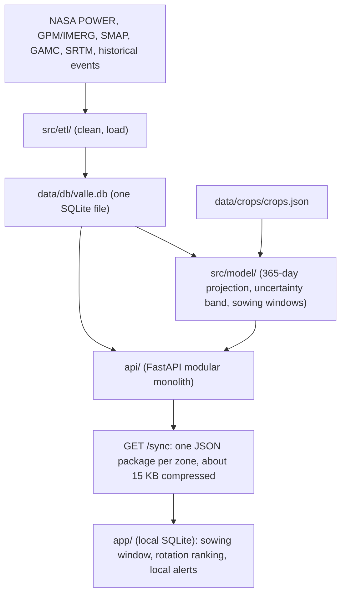

# Choclito

**Field Shift: Adapting Farms with NASA Data** (NASA Space Apps Challenge 2026).

Choclito is a decision-support app for small farmers in the peri-urban zones of Cercado, Cochabamba (Bolivia). It combines NASA climate data (POWER, GPM IMERG, SMAP) with local information (crops, water sources, the farmer's priority) and answers three questions:

1. **When should I sow this crop next year?** The optimal sowing-to-harvest window with a confidence band, computed by comparing the crop's optimal conditions against a 365-day climate projection.
2. **What should I plant after this one?** At least 3 rotation strategies, including the current one, ranked by the farmer's goal (save water, better soil, fodder, sell) with local evidence.
3. **What should I prepare for?** Alerts 1 to 2 weeks ahead, when the projection repeats the pattern that preceded historical frost, hail, drought or flood events, plus a 14-day short forecast for "Hoy" and the calendar.

The app **supports, never replaces**, the farmer's judgment. It is built to depend on the internet as little as possible: it syncs with the server only when a connection is available, and one `/sync` request delivers the whole package for a zone (catalog, projection, short forecast, rotations, alerts) in about 15 KB compressed (around 100 KB as JSON). All comparisons run on the phone, and the screens show "actualizado + date" instead of blocking on the network.

Pilot zones: District 9 (Itocta) and District 10 (Adela Zamudio), among the other GAMC zones of the study area.

## Start here

| I want to... | Read |
|---|---|
| Understand who the users are and the product principles | [PRODUCT.md](PRODUCT.md) |
| Know every screen and flow of the app | [docs/FLUJO-APP.md](docs/FLUJO-APP.md) |
| See the approved visual design (tokens are normative) | [DESIGN.md](DESIGN.md) and [mockups/](mockups/) |
| Know the exact API endpoints and payloads | [docs/API-CONTRACT.md](docs/API-CONTRACT.md) |
| See where every data value comes from | [docs/DATA-SOURCES.md](docs/DATA-SOURCES.md) and [data/README.md](data/README.md) |
| Understand the crop catalog and scoring rules | [data/crops/README.md](data/crops/README.md) |
| Understand the time-series model and its validation | [src/model/README.md](src/model/README.md) and [src/model/TRAINING.md](src/model/TRAINING.md) |
| See the database tables | [docs/db-schema.md](docs/db-schema.md) |
| Know what is left to do | [docs/BACKLOG.md](docs/BACKLOG.md) |
| Contribute (branches, commits, PRs, rules) | [AGENTS.md](AGENTS.md) |
| Read the challenge statement and local context research | [docs/research/](docs/research/) |

## How it works



- **ETL** (`src/etl/`): downloads, cleans and loads each source into one SQLite file (`data/db/valle.db`). Re-runnable without duplicating rows.
- **Model** (`src/model/`): a Fourier + linear-trend seasonal model (10 coefficients, least squares) projects tmin/tmax/tmean/pmm for 365 days with an uncertainty band; it also scores the optimal sowing window per crop and is validated with a 2024-25 holdout (MAE tmean 1.17, pmm 3.09 C/mm).
- **API** (`api/`): a FastAPI modular monolith that serves zones, crops, the projection, the short forecast, alerts, rotations, history, reports and the `/sync` package for the app.
- **App** (`app/`): Expo (React Native + TypeScript), one codebase for Android and web. Screens read from local SQLite, never block on the network, and show "actualizado + date".

## Repository map

```
app/        Expo app (Android + web): screens in app/, logic in src/
api/        FastAPI modular monolith, openapi.yaml, api/tests/
src/etl/    Data extraction, cleaning and loading scripts
src/model/  Projection, scoring, backtest, EDA
data/       Processed data: crops catalog, POWER, IMERG, SMAP, GAMC, SRTM,
            events, model outputs, data/db/valle.db (the API database)
docs/       API contract, app flows, data sources, db schema, backlog,
            research/, plots/ (model figures)
mockups/    Approved HTML mockups, one file per screen
tests/      Data/model tests (scoring, seasonal, pipeline)
Makefile    api, db-init, db-load, forecast, weather, test, web
etl.sh      Step-by-step ETL orchestrator
```

## Stack

**Mobile-first, one codebase for Android and web.** The app is designed for low-end phones with little signal. If the APK is not ready in time, the same code is published as a web app for the demo.

### App (`app/`)

| Part | Technology | Why |
|---|---|---|
| Framework | **Expo** (React Native + TypeScript) | Native Android and, from the same code, web via `react-native-web`. |
| Navigation | **Expo Router** | Hoy / Calendario / Sembrar / Mi zona tabs and bottom sheets, file-based (`app/app/`). |
| Offline data | **expo-sqlite** | Local database with the `/sync` package; the app works without signal. |
| Notifications | **expo-notifications** (local) | Alerts and harvest reminders without depending on the server. |
| Location | **expo-location** | GPS to find the farmer's zone. |
| Voice | **expo-speech** | "Escuchar" (listen) button. |
| Maps and charts | **react-native-svg** | Plot and zone maps drawn in SVG: same result on Android and web. |
| State | **Zustand** | Simple and light for low-end phones. |
| Text | **i18next** | Spanish and Quechua from day one. |
| Design | Tokens from [DESIGN.md](DESIGN.md) | Atkinson Hyperlegible Next, text of at least 17 px, touch targets of at least 56 px. |

### API (`api/`)

| Part | Technology | Why |
|---|---|---|
| Framework | **FastAPI** (Python 3.13) | Automatic OpenAPI and the same language as the ETL and models. |
| ORM | **SQLModel** | Models are both tables and response schemas. |
| Database | **SQLite** (single file) | Zero setup. |
| Contract | [docs/API-CONTRACT.md](docs/API-CONTRACT.md) + `api/openapi.yaml` | Frontend and backend work in parallel; both change together. |
| Mock | **Prism** (`prism mock api/openapi.yaml`) | The frontend starts against the mock before the API exists. |

### Data and models (`src/`, `data/`)

| Part | Technology |
|---|---|
| Language | Python 3.13 (single `uv` project at the repo root: `pyproject.toml`) |
| NASA access | `earthaccess` (Earthdata), NASA POWER API |
| Files | `xarray` + `netCDF4` (IMERG), `h5py` (SMAP) |
| Geometry | `shapely` |
| Analysis | `pandas`, `numpy`, `matplotlib` |
| Time series | Fourier + linear trend (reference implementation in `src/model/seasonal.py`) |
| Window scoring | Python reference + JSON test vectors that the app (TypeScript) must reproduce |

### Tooling

| Use | Tool |
|---|---|
| Python | `uv` (environments and dependencies) |
| JS | `pnpm` + Expo CLI (in `app/`) |
| Tests | `pytest` (API and data), `jest` (app) |
| Formatting | `ruff` (Python), `prettier` + `eslint` (TS) |

## Quick start

Prerequisites: Python 3.13, [uv](https://docs.astral.sh/uv/), pnpm (in `app/`).

```bash
# 1. Environment
uv sync

# 2. Database: create tables, then load the ETL data
make db-init
make db-load

# 3. API on http://localhost:8000 (docs at /docs)
make api

# 4. Tests (73+ tests: API, data, model)
make test
```

App in the browser (recommended; expo-sqlite needs the cross-origin isolation headers that `app/scripts/serve-web.mjs` sends):

```bash
make web    # http://localhost:8081, reads EXPO_PUBLIC_API_URL (default http://localhost:8000)
```

App on Android: `cd app && pnpm install && pnpm android` (Expo Go).

Refresh jobs (run with cron on the server):

```bash
make weather     # 14-day short forecast (Open-Meteo) into the weather table, every 6 hours
make forecast    # regenerate the 365-day projection and replace the forecasts table, weekly
```

## Database

One SQLite file, `data/db/valle.db`, with tables defined by the SQLModel models of each module. `make db-init` creates them, `make db-load` loads the ETL data. Details in [docs/db-schema.md](docs/db-schema.md). Each data folder has its own README with inputs, outputs, periods and time conventions (IMERG dates are UTC).

## Architecture

The API is a **modular monolith**: one FastAPI process and one SQLite database, split into modules by domain. Each module owns its tables and exposes a service; other modules only talk to it through that service.

```
api/
  main.py             App factory, mounts every module router
  core/               Config, DB engine/session, errors, shared utils
  modules/
    zones/            Agricultural zones (GAMC grid)
    crops/            Crop catalog
    climate/          Short forecast, 365-day projection, climatology, history
    water/            Water sources
    alerts/           Alert rules and active alerts
    rotations/        Rotation plans and scores
    reports/          Farmer reports and zone map
    feedback/         Harvest results and chosen plans
    sync/             /sync package for the app (composes other services)
```

Every module has the same files:

| File | Responsibility |
|---|---|
| `router.py` | HTTP only: parse the request, call the service, return the schema. No business logic, no queries. |
| `service.py` | Business logic. The only public entry point of the module. |
| `repository.py` | Database access with SQLModel sessions. Used only by its own service. |
| `models.py` | SQLModel tables owned by the module. |
| `schemas.py` | Request/response models that match `docs/API-CONTRACT.md`. |

Rules between modules:

- `router → service → repository`. Never skip a layer.
- A module may call another module's `service`, never its `repository` or `models`.
- `sync` only composes services; it owns no tables.
- Data jobs in `src/` write through the service of the module that owns the table.
- The API returns codes, not sentences; the app translates.

## Conventions

All contribution rules live in [AGENTS.md](AGENTS.md). The short version:

- Code, comments, commits and PRs in **English**; user-facing text and catalog data in **Spanish** (+ Quechua in the app). No emojis.
- One issue, one branch, one PR; base branch `develop`.
- `docs/API-CONTRACT.md` is the source of truth for the API; contract changes go with `api/openapi.yaml` in the same PR.
- Never invent data: every value has a source and units. No large raw files (NetCDF, HDF5, GeoTIFF) in git.
- New logic needs tests. Run `ruff` + `pytest` (Python) and `eslint` + `prettier` + `jest` (TS) before pushing.

## Acknowledgements

NASA (POWER, GPM IMERG, SMAP via Earthdata), GAMC Cochabamba (zone grid and parcel maps), Open-Meteo (short forecast), and the local farmers and agronomists of Cercado who provided the crop parameters and historical events.
