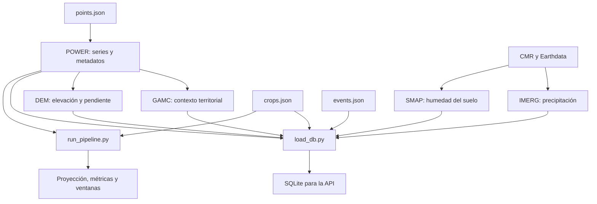

# Datos: fuentes, ejecución e integración

Esta carpeta reúne las salidas de las fuentes ambientales, el contexto territorial, los catálogos agronómicos y los resultados del modelo. Los scripts se conservan en `src/etl/` y `src/model/`; cada README indica la entrada y salida de su proceso. El flujo completo de extracción y consolidación, con diagramas, está en [src/etl/README.md](../src/etl/README.md).

## Guías por carpeta

| Carpeta | Qué contiene | Script principal |
|---|---|---|
| [power/](power/README.md) | Clima diario y metadatos por zona | `src/etl/power_etl.py` |
| [imerg/](imerg/README.md) | Precipitación satelital agregada del valle | `src/etl/imerg_etl.py`; flujo por celdas en `imerg/imerg.py` |
| [smap/](smap/README.md) | Humedad superficial y radicular | `src/etl/smap_etl.py` |
| [gamc/](gamc/README.md) | Contexto municipal y capturas cartográficas | `src/etl/gamc_etl.py` |
| [srtm/](srtm/README.md) | Elevación y pendiente consultadas vía Open-Meteo | `src/etl/srtm_etl.py` |
| [crops/](crops/README.md) | Catálogo curado de cultivos y parámetros | Lectura en `src/model/scoring.py` y `src/etl/load_db.py` |
| [events/](events/README.md) | Referencias de eventos con fecha y procedencia | Curación manual y `src/etl/load_db.py` |
| [db/](db/README.md) | Base SQLite integrada para la API | `src/etl/load_db.py` |
| [model/](model/README.md) | Proyección, métricas y ventanas por cultivo | `src/model/run_pipeline.py` |

## Preparación

Ejecutar desde la raíz del repositorio con Python 3.13 y el entorno del proyecto. Las dependencias principales se definen en [pyproject.toml](../pyproject.toml); el programa independiente IMERG tiene su propia lista en [src/etl/imerg/requirements.txt](../src/etl/imerg/requirements.txt).

- Puntos por zona: [src/etl/points.json](../src/etl/points.json).
- Área del programa por celdas IMERG: [cochabamba-estudio.geojson](../src/etl/imerg/areas/cochabamba-estudio.geojson).
- Acceso a descargas NASA: `EARTHDATA_TOKEN`, según el lector de cada script.
- Acceso municipal: `GAMC_API_KEY` en `.env` de la raíz para el extractor GAMC.

Los README de las fuentes describen periodos, agregación espacial y convención temporal. Las fechas IMERG son UTC; POWER conserva la convención de su consulta. `zone_id` relaciona los atributos territoriales y `fecha` relaciona las series.

## Orden de ejecución

1. POWER genera series y metadatos de las zonas.
2. IMERG y SMAP generan las series ambientales del valle.
3. GAMC y relieve utilizan las coordenadas de los metadatos POWER.
4. El cargador incorpora las fuentes, los cultivos y los eventos a SQLite.
5. El comando del modelo produce archivos de proyección, evaluación y ventanas.

El [orquestador etl.sh](../etl.sh) ejecuta POWER, IMERG, SMAP, GAMC, relieve y carga, en ese orden. Puede invocarse completo o por pasos. Los comandos siguientes son alternativas de ejecución:

```bash
bash etl.sh
bash etl.sh imerg smap
bash etl.sh gamc srtm
bash etl.sh db
```

`etl.sh` usa `.venv/bin/python` si está disponible y, en otro caso, `python3`. Sus periodos y rutas están definidos en el script. Cada extractor documenta si reanuda registros existentes o vuelve a escribir su salida.

La generación del modelo se invoca por separado:

```bash
uv run python -m src.model.run_pipeline --power data/power/D1_tunari_daily.csv --crops data/crops/crops.json --out data/model --eda docs/EDA.md --horizon 365
```

## Convenciones de almacenamiento

Se conservan las carpetas actuales: cada fuente mantiene sus CSV/JSON junto a su README. Las capturas GAMC continúan en `gamc/04/`. Los archivos globales temporales se gestionan en los directorios de descarga de cada programa. Conservar manifiestos y procedencia al compartir resultados, y mantener credenciales fuera de los archivos versionados.

Las variables originales y derivadas se describen por nombre, significado y unidad en cada guía. Las series ambientales describen condiciones; el catálogo de cultivos aporta parámetros y los eventos aportan referencias históricas. El consumo del modelo y las salidas integradas se documentan por separado.

## Flujo general


