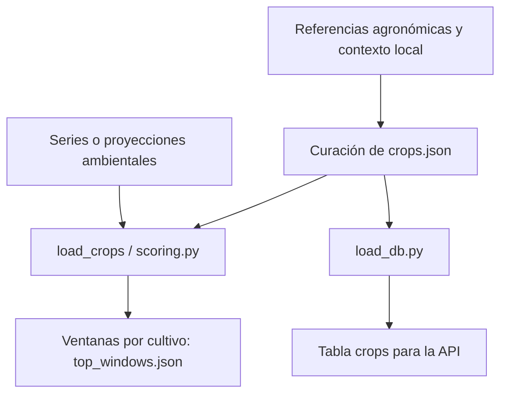

# Catálogo de cultivos y parámetros agronómicos

## Origen y propósito

[crops.json](crops.json) es el catálogo curado del proyecto para el Cercado de Cochabamba. Reúne información de [CROPS.md](../../docs/CROPS.md) y referencias agronómicas/locales identificadas en cada cultivo. Contiene identidad del cultivo, ciclo, temperatura, sensibilidad al clima, coeficientes de agua y características útiles para comparar rotaciones.

La incorporación de información es manual y documentada; no hay un descargador de API para este catálogo. La procedencia se registra en `fuente` y, para temperatura, `temp.fuente`. Los valores `local` y `estimado` identifican el tipo de referencia del catálogo.

## Scripts y ejecución

- [scoring.py](../../src/model/scoring.py): `load_crops()` lee `crops.json`; `score_windows()` compara ventanas climáticas con sus parámetros.
- [run_pipeline.py](../../src/model/run_pipeline.py): utiliza `--crops` para generar ventanas por cultivo.
- [load_db.py](../../src/etl/load_db.py): transforma el catálogo en registros de la tabla `crops`.

Desde la raíz, para consumir el catálogo con la serie POWER existente:

```bash
uv run python -m src.model.run_pipeline --power data/power/D1_tunari_daily.csv --crops data/crops/crops.json --out data/model --eda docs/EDA.md --horizon 365
```

Para integrarlo a SQLite: `uv run python -m src.etl.load_db --db data/db/valle.db`. La carga también incorpora las demás fuentes disponibles.

## Diccionario del catálogo

| Campo | Significado | Unidad / tipo |
|---|---|---|
| `version`, `actualizado`, `zona` | Versión, fecha de actualización y ámbito del catálogo | Metadatos |
| `variables`, `leer` | Variables compartidas y documento de lectura | Lista / ruta |
| `id` | Identificador utilizado por scripts, base y aplicación | Texto estable |
| `nombre`, `cientifico`, `tipo` | Nombre común, científico y grupo de cultivo | Texto |
| `tipo_ciclo` | Clasificación anual o perenne | Categoría |
| `ciclo_dias` | Intervalo de duración del ciclo | Días, `[mínimo, máximo]` |
| `temp.tmean_opt` | Rango de temperatura media óptima registrado | °C, `[mínimo, máximo]` |
| `temp.fuente` | Tipo de referencia del rango térmico | `local` / `estimado` |
| `helada.tolerancia`, `helada.etapa_critica` | Tolerancia cualitativa al frío y fase sensible | Categoría / texto |
| `agua.demanda`, `agua.deficit_tol` | Demanda de agua y tolerancia cualitativa al déficit | Categorías |
| `kc.inicial`, `kc.medio`, `kc.final` | Coeficientes de cultivo por etapa, utilizados con ET₀ | Adimensional |
| `altitud` | Contexto altitudinal del cultivo | Categoría |
| `erosion_sens`, `granizo_sens` | Sensibilidad cualitativa a erosión y granizo | Categorías |
| `fix_n` | Capacidad de fijación de nitrógeno registrada | Booleano |
| `breaks_pest_cycle` | Aporte a interrumpir ciclos de plagas | Booleano |
| `forage_value`, `drought_tolerant`, `deep_rooting` | Valor forrajero, tolerancia a sequía y raíces profundas | Categorías / booleano |
| `etapas` | Hitos del desarrollo como pares `[día, código]` | Días y texto |
| `cosechas_cada_dias` | Intervalo de cortes/cosechas cuando está presente | Días |
| `mercado`, `siembra_local`, `rotacion` | Contexto comercial, calendario local y secuencia agrícola | Texto |
| `foto`, `foto_url` | Referencia visual cuando está presente | Ruta / URL |
| `fuente` | Referencia que respalda la ficha del cultivo | Texto |

## Variables ambientales relacionadas

| Variable | Qué representa | Unidad |
|---|---|---|
| `tmean`, `tmin`, `tmax` | Temperatura del aire | °C |
| `pmm` | Precipitación diaria | mm/día |
| `rh` | Humedad relativa del aire | % |
| `sw` | Energía solar diaria descendente | MJ/m²/día |
| `ws` | Velocidad del viento | m/s |
| `et0` | Evapotranspiración de referencia calculada | mm/día |
| `sm_surface`, `sm_root` | Humedad volumétrica superficial y radicular | m³/m³ |

El evaluador combina temperatura, agua, heladas y el indicador territorial de drenaje. Usa el promedio de los tres `Kc`, una duración media del ciclo y constantes de puntuación definidas en `scoring.py`. El resultado es un puntaje de aptitud de ventana y una confianza heurística. Los campos de contexto también se conservan para la aplicación y comparación de alternativas.

## Cultivos incluidos

- `papa`: Papa (anual).
- `choclo`: Maíz / choclo (anual).
- `trigo`: Trigo (anual).
- `papaliza`: Papaliza / papalisa (anual).
- `lechuga`: Lechuga (anual).
- `hortalizas`: Hortalizas (cebolla, zanahoria, repollo, acelga) (anual).
- `alfalfa`: Alfalfa (perenne).
- `haba`: Haba (anual).
- `tarwi`: Tarwi / chocho (anual).
- `quinua`: Quinua de valle (anual).
- `avena`: Avena forrajera (anual).
- `durazno`: Durazno (perenne).
- `flores`: Flores (margaritas, claveles) (anual).
- `maiz_forraje`: Maíz forraje (silaje) (anual).

## Flujo


