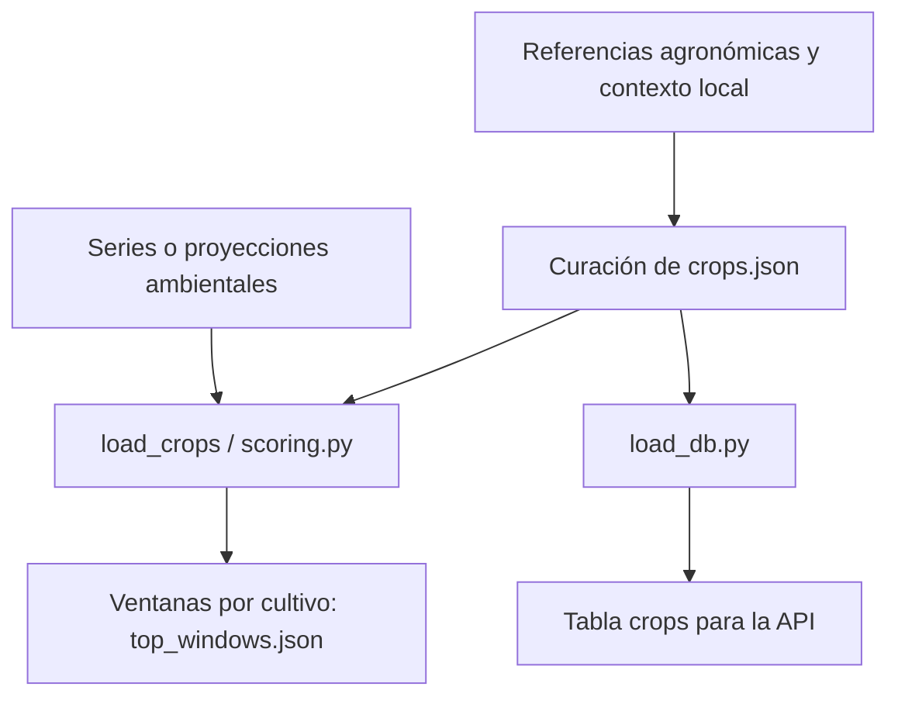

# Catálogo de cultivos y parámetros agronómicos

## Origen y propósito

[crops.json](crops.json) es el catálogo curado del proyecto para el Cercado de Cochabamba. Reúne información de [CROPS.md](../../docs/CROPS.md) y referencias agronómicas/locales identificadas en cada cultivo. Contiene identidad del cultivo, ciclo, temperatura, sensibilidad al clima, coeficientes de agua y características útiles para comparar rotaciones.

La incorporación de información es manual y documentada; no hay un descargador de API para este catálogo. La procedencia se registra en `fuente` y, para temperatura, `temp.fuente`. Los valores `local` y `estimado` identifican el tipo de referencia del catálogo.

## Scripts y ejecución

- [scoring.py](../../src/model/scoring.py): `load_crops()` lee `crops.json`; `score_windows()` compara ventanas climáticas con sus parámetros.
- [run_pipeline.py](../../src/model/run_pipeline.py): utiliza `--crops` para generar ventanas por cultivo.
- [load_db.py](../../src/etl/load_db.py): transforma el catálogo en registros de la tabla `crops`.

Desde la raíz, para consumir el catálogo con la DB consolidada:

```bash
uv run python -m src.model.run_pipeline --db data/db/valle.db --crops data/crops/crops.json --out data/model --eda docs/EDA.md
```

Para integrarlo a SQLite: `uv run python -m src.etl.load_db --db data/db/valle.db`. La carga también incorpora las demás fuentes disponibles.

## Diccionario del catálogo

| Campo | Significado | Unidad / tipo |
|---|---|---|
| `version`, `actualizado`, `zona` | Versión, fecha de actualización y ámbito del catálogo | Metadatos |
| `variables`, `leer` | Variables compartidas y documento de lectura | Lista / ruta |
| `id` | Identificador utilizado por scripts, base y aplicación | Texto estable |
| `nombre`, `cientifico`, `tipo` | Nombre común, científico y grupo de cultivo | Texto |
| `tipo_ciclo` | Clasificación anual o perenne | Categoría |
| `ciclo_dias` | Intervalo de duración del ciclo | Días, `[mínimo, máximo]` |
| `temp.tmean_opt` | Rango de temperatura media óptima registrado | °C, `[mínimo, máximo]` |
| `temp.fuente` | Tipo de referencia del rango térmico | `local` / `estimado` |
| `helada.tolerancia`, `helada.etapa_critica` | Tolerancia cualitativa al frío y fase sensible | Categoría / texto |
| `agua.demanda`, `agua.deficit_tol` | Demanda de agua y tolerancia cualitativa al déficit | Categorías |
| `kc.inicial`, `kc.medio`, `kc.final` | Coeficientes de cultivo por etapa, utilizados con ET₀ | Adimensional |
| `altitud` | Contexto altitudinal del cultivo | Categoría |
| `erosion_sens`, `granizo_sens` | Sensibilidad cualitativa a erosión y granizo | Categorías |
| `fix_n` | Capacidad de fijación de nitrógeno registrada | Booleano |
| `breaks_pest_cycle` | Aporte a interrumpir ciclos de plagas | Booleano |
| `forage_value`, `drought_tolerant`, `deep_rooting` | Valor forrajero, tolerancia a sequía y raíces profundas | Categorías / booleano |
| `etapas` | Hitos del desarrollo como pares `[día, código]` | Días y texto |
| `cosechas_cada_dias` | Intervalo de cortes/cosechas cuando está presente | Días |
| `mercado`, `siembra_local`, `rotacion` | Contexto comercial, calendario local y secuencia agrícola | Texto |
| `foto`, `foto_url` | Referencia visual cuando está presente | Ruta / URL |
| `fuente` | Referencia que respalda la ficha del cultivo | Texto |

En el MVP, el scoring usa `tmean`, `tmin`, `pmm` y `et0` (las variables con evidencia local
por cultivo). Las demás se cargan pero puntúan **neutro** (sin evidencia no se penaliza).

## Variables ambientales relacionadas

| Variable | Qué representa | Unidad |
|---|---|---|
| `tmean`, `tmin`, `tmax` | Temperatura del aire | °C |
| `pmm` | Precipitación diaria | mm/día |
| `rh` | Humedad relativa del aire | % |
| `sw` | Energía solar diaria descendente | MJ/m²/día |
| `ws` | Velocidad del viento | m/s |
| `et0` | Evapotranspiración de referencia calculada | mm/día |
| `sm_surface`, `sm_root` | Humedad volumétrica superficial y radicular | m³/m³ |

El evaluador combina temperatura, agua, heladas y el indicador territorial de drenaje. Usa el promedio de los tres `Kc`, una duración media del ciclo y constantes de puntuación definidas en `scoring.py`. El resultado es un puntaje de aptitud de ventana y una confianza heurística. Los campos de contexto también se conservan para la aplicación y comparación de alternativas.

## Reglas de scoring (motor implementado, tarea 2.4)

> Esta sección documenta **lo que implementa `src/model/scoring.py`** (fuente de verdad);
> el motor idéntico corre en servidor y en el dispositivo móvil.

Para cada ventana de L días (L = media de `ciclo_dias`) sobre la proyección:

1. **Temperatura** (0–1): fracción de días con `tmean` dentro de `tmean_opt`.
2. **Agua** (0–1): `déficit = Σ max(0, ET₀×Kc_avg − pmm)`, con `Kc_avg` = media de los tres
   `kc`; mitigado por `drought_tolerant` (no=1.0, poco=0.6, sí=0.3);
   `agua = 1 − min(1, déficit×mit / (2 mm/día × L))`.
3. **Helada** (0–1): `helada = 1 − sev × días_helada / L`, con `sev` por `tolerancia`
   (alta=0.2, media=0.5, baja=1.0) y `días_helada` = días con `tmin + FROST_OFFSET < 0`
   (`FROST_OFFSET = 0.0`; el tmin observado ya captura heladas reales, ver EDA.md).
4. **Erosión** (multiplicador 0.5–1.0): si la zona tiene `cerca_drenaje` y
   `erosion_sens` = alta (0.5) o media (0.75).
5. **Score final** = 100 × (0.45·temp + 0.40·agua + 0.15·helada) × erosión (1 decimal).
   **Confianza** = decaimiento heurístico con el horizonte: `0.92 − 0.5×centro`,
   recortado a [0.4, 0.9] según el centro de la ventana dentro de la proyección;
   sin horizonte (ventana suelta) vale 0.7.
6. **Top-3**: mejores ventanas separadas ≥ 14 días.

Post-MVP (documentado, no implementado): `etapa_critica` (penalizar solo el sub-rango de la
etapa sensible) y `tipo_ciclo = perenne` (época de siembra en vez de ventana fija).

## Salida de `score_window` (tarea 12a)

`score_window(cultivo, zona, tmean, tmin, pmm, et0, horizonte, pos)` devuelve:

| Campo | Significado |
|---|---|
| `score` | 0–100, 1 decimal |
| `veredicto` | `bueno` (≥ 70) · `con_cuidado` (≥ 40) · `malo`; umbrales configurables (`umbral_bueno`/`umbral_malo`) |
| `confianza` | 0.4–0.9 (heurística del punto 5) |
| `motivos` | Códigos (no frases; la app traduce por i18n), en orden fijo |
| `detalle` | `temp`, `agua`, `helada`, `erosion`, `deficit_mm`, `frost_days` |

Códigos de `motivos` (aparecen solo si el valor mostrado correspondiente es no nulo):

| Código | Condición |
|---|---|
| `temp_fuera_rango` | `detalle.temp < 1.0` |
| `deficit_agua` | `detalle.deficit_mm > 0` |
| `heladas` | `detalle.frost_days > 0` |
| `erosion_riesgo` | `detalle.erosion < 1.0` |

**Contrato de portabilidad:** [test_vectors.json](../model/test_vectors.json) publica 16
vectores (entrada → salida esperada) que la app móvil debe reproducir exactamente
(issue #37 [T12a]); los tests de `tests/test_scoring.py` los corren contra esta función.

## Cultivos del catálogo (14)

| id | Ciclo (días) | T óptima media | Helada | Agua | FixN |
|---|---|---|---|---|---|
| papa | 120–180 | 15–20 °C (local) | baja | alta | ❌ |
| choclo | 120–240 | 18–27 °C (estimado) | baja | alta | ❌ |
| trigo | 120–150 | 12–22 °C (estimado) | media (espigazón) | media | ❌ |
| papaliza | 180–210 | 8–14 °C (local) | alta | media | ❌ |
| lechuga | 28–42 | 10–18 °C (local, derivado) | baja | muy alta | ❌ |
| hortalizas | 30–90 | 10–20 °C (local) | baja | muy alta | ❌ |
| alfalfa | perenne (sep–mar) | 15–25 °C (estimado) | media | muy alta | ✅ |
| haba | 150–180 | 8–18 °C (estimado) | alta | media | ✅ |
| tarwi | 180–240 | 10–20 °C (estimado) | alta | media-baja | ✅ (50+ kg N/ha) |
| quinua | 150–180 | 12–22 °C (estimado) | media (post-floración) | media | — |
| avena | 90–120 | 8–18 °C (estimado) | alta | media | — |
| durazno | perenne (plantar invierno) | 12–24 °C (estimado) | media (floración) | media | ❌ |
| flores | 60–180 | 12–22 °C (estimado) | baja | alta | ❌ |
| maiz_forraje | 120–150 | 18–27 °C (estimado) | baja | alta | ❌ |

> Los valores marcados **estimado** son agronómicos generales (FAO/tipos de cultivo), no
> fuentes locales: validarlos con un agrónomo local si hay tiempo (o descartar el fit_T para
> ese cultivo y basarse en helada+agua, que sí tienen evidencia local).

## Cultivos incluidos

- `papa`: Papa (anual).
- `choclo`: Maíz / choclo (anual).
- `trigo`: Trigo (anual).
- `papaliza`: Papaliza / papalisa (anual).
- `lechuga`: Lechuga (anual).
- `hortalizas`: Hortalizas (cebolla, zanahoria, repollo, acelga) (anual).
- `alfalfa`: Alfalfa (perenne).
- `haba`: Haba (anual).
- `tarwi`: Tarwi / chocho (anual).
- `quinua`: Quinua de valle (anual).
- `avena`: Avena forrajera (anual).
- `durazno`: Durazno (perenne).
- `flores`: Flores (margaritas, claveles) (anual).
- `maiz_forraje`: Maíz forraje (silaje) (anual).

## Equivalencias de ids con los mockups

La app usa los ids del catálogo. Correspondencia con los ids de los mockups:

| Mockup | Catálogo | Nota |
|---|---|---|
| `maiz` (maíz choclo) | `choclo` | Cambiar en la app |
| `forraje` (maíz forraje) | `maiz_forraje` | Agregado en v3 |
| `cebolla`, `zanahoria` | `hortalizas` | La app los muestra separados |
| `papa`, `haba`, `avena`, `alfalfa`, `lechuga` | igual | |

## Flujo


