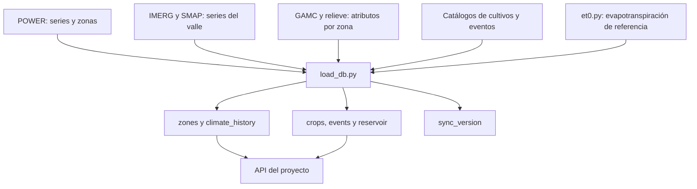

# SQLite: integración de las fuentes

## Propósito y entradas

La base `valle.db` reúne las salidas de los extractores y catálogos. [load_db.py](../../src/etl/load_db.py) usa los modelos SQLModel definidos en `api/modules/` y la inicialización de [api/core/db.py](../../api/core/db.py).

| Entrada | Contenido que incorpora |
|---|---|
| `data/power/*_meta.json` | Identidad, coordenadas y metadatos de zonas |
| `data/power/*_daily.csv` | Variables meteorológicas por zona y fecha |
| `data/imerg/imerg_valle_daily.csv` | Lluvia satelital del valle por fecha |
| `data/smap/smap_valle_daily.csv` | Humedad superficial y radicular por fecha |
| `data/gamc/zones_gamc.json` | Contexto municipal por identificador de zona |
| `data/srtm/srtm_zones.json` | Elevación y pendiente por zona |
| `data/crops/crops.json` | Parámetros del catálogo agronómico |
| `data/events/events.json` | Referencias de eventos con fuente |

## Ejecución

Desde la raíz, con el entorno del proyecto preparado:

```bash
uv run python -m src.etl.load_db --db data/db/valle.db
```

`--db` permite seleccionar otra base de salida. `bash etl.sh db` ejecuta la integración del orquestador. Primero deben existir las salidas de las fuentes que se desean incorporar.

## Cómo integra y guarda

1. Inicializa las tablas a partir de los modelos de la API.
2. Relaciona metadatos, GAMC y relieve por `zone_id`; toma la elevación del archivo de relieve cuando está disponible.
3. Lee POWER y une IMERG/SMAP por fecha. Las series agregadas del valle se asocian a las zonas procesadas.
4. Calcula `et0` con [et0.py](../../src/model/et0.py), a partir de temperaturas y día del año.
5. Carga el catálogo de cultivos y reemplaza la colección de eventos por su versión de entrada.
6. Conserva una referencia histórica de La Angostura y registra una versión de sincronización con fecha UTC.

La escritura de zonas, clima, cultivos y embalse usa actualización/inserción por clave primaria. Las tablas de la aplicación (`reports`, `feedback`, `plans`) quedan fuera de la carga de fuentes.

## Tablas y significado

| Tabla | Datos principales | Clave / unidades |
|---|---|---|
| `zones` | Nombre, comuna, distrito, latitud, longitud, elevación, pendiente e indicadores territoriales | `id`; grados WGS84, m y grados de pendiente |
| `climate_history` | `tmin`, `tmax`, `tmean`, `pmm`, `rh`, `sw`, `ws`, `et0`, `sm_surface`, `sm_root`, `pmm_sat` | `zone_id` + `fecha` |
| `crops` | Rangos térmicos, ciclo mínimo/máximo, tolerancias, coeficientes y contexto del cultivo | `id`; °C, días y Kc adimensional |
| `events` | Tipo, fecha, zona, descripción y fuente | `id` |
| `reservoir` | Referencia histórica del embalse: nombre, nivel, volumen, estado y fecha | `id`; % y hm³ cuando existe volumen |
| `sync_version` | Registro de carga y sincronización | Identificador y fecha UTC |

En `climate_history`, temperaturas se expresan en °C; `pmm` (POWER), `pmm_sat` (IMERG) y `et0`, en mm/día; `rh`, en %; `sw`, en MJ/m²/día; `ws`, en m/s; y humedades del suelo, en m³/m³. `NULL` representa un valor no disponible. `pmm` y `pmm_sat` conservan su procedencia diferenciada.

El cargador aplica su regla de selección de lluvia POWER antes de guardarla y convierte valores no finitos de las series numéricas a `NULL`. La definición de cada campo de entrada está en el README de su fuente. La referencia de `reservoir` se identifica como histórica con su fecha de 2002.

## Consulta de lectura

```bash
sqlite3 -readonly data/db/valle.db "SELECT zone_id, MIN(fecha), MAX(fecha), COUNT(*) FROM climate_history GROUP BY zone_id;"
```

La base permite servir clima y contexto desde la API. La generación de archivos del modelo tiene su propio comando, documentado en [model/README.md](../model/README.md).

## Flujo


