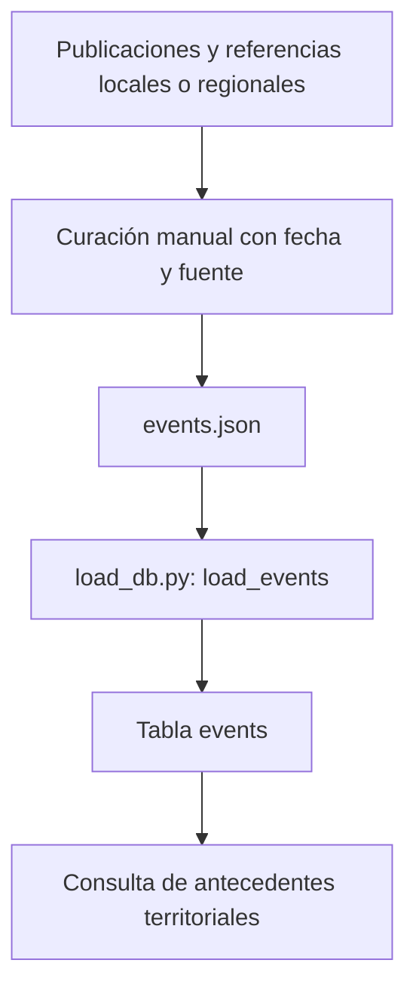

# Eventos climáticos e hídricos de referencia

## Fuente y obtención

[events.json](events.json) es una colección curada manualmente de hechos reportados por prensa, agencias y organizaciones citadas en cada registro. Su contexto ampliado está en [CONTEXTO-LOCAL.md](../../docs/CONTEXTO-LOCAL.md) y [LOCAL-CONTEXT.md](../../docs/LOCAL-CONTEXT.md).

La colección permite relacionar fechas y tipos de evento con las series ambientales y mostrar antecedentes territoriales. Conserva eventos locales y referencias regionales según la descripción de cada registro. No consulta una API ni realiza scraping al ejecutar el cargador.

## Script y ejecución

[load_db.py](../../src/etl/load_db.py), función `load_events()`, lee el catálogo, traduce `zona_id` a la columna `zone_id` y carga la tabla `events`. En cada carga reemplaza el contenido de esa tabla por el catálogo vigente.

Desde la raíz, con el entorno del proyecto y los archivos de las fuentes disponibles:

```bash
uv run python -m src.etl.load_db --db data/db/valle.db
```

El comando carga también las otras fuentes; `bash etl.sh db` invoca el paso de integración. Para incorporar una referencia, actualizar manualmente el catálogo con fecha, ámbito, descripción y fuente, y después volver a cargarlo.

## Diccionario de datos

| Campo | Qué representa | Tipo / referencia |
|---|---|---|
| `version` | Versión del catálogo | Entero |
| `actualizado` | Fecha de revisión del catálogo | `YYYY-MM-DD` |
| `zona` | Ámbito territorial descrito por la colección | Texto |
| `nota` | Convención de clasificación y asignación territorial | Texto |
| `events` | Lista de referencias de eventos | Lista |
| `tipo` | Clase de evento: sequía, helada, granizo o inundación | Código |
| `fecha` | Fecha registrada para el hecho referido | `YYYY-MM-DD` |
| `zona_id` | Zona del proyecto asociada a la referencia, cuando existe | Texto o `null` |
| `descripcion` | Relato del impacto y contexto del hecho | Texto |
| `fuente` | Medio, entidad o publicación de procedencia | Texto |

En SQLite se añade `id` como identificador del registro. Las cifras y unidades citadas dentro de una descripción se conservan como parte del texto de la fuente; no se extraen como medidas meteorológicas estructuradas.

## Salida y uso

El catálogo de entrada permanece en esta carpeta. La salida integrada es la tabla `events` de la base indicada con `--db`. Al relacionar una referencia con clima, conservar su ámbito territorial y la procedencia junto a la fecha.

## Flujo


