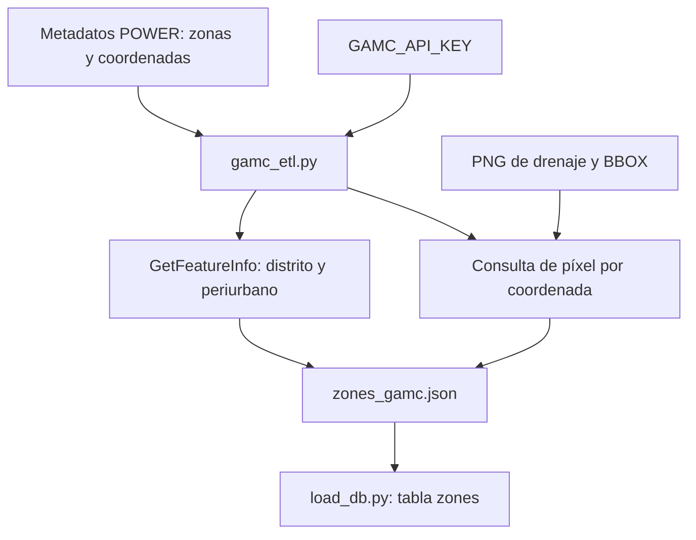

# GAMC: contexto territorial de las zonas

## Fuente y archivos de referencia

Los servicios del proyecto municipal 04 aportan contexto de distritos, comunas, periurbanos y drenaje para Cochabamba. [Catálogo oficial](https://recursosgamc.cochabamba.bo/api-doc).

El endpoint es `https://serviciosgamc.cochabamba.bo/api/gs/wms`, protocolo WMS 1.1.1. La carpeta [04/](04/README.md) conserva mapas, leyendas y ejemplos de consultas; se mantiene su organización actual. El detalle del acceso está en [GAMC-ACCESS.md](../../docs/GAMC-ACCESS.md).

## Script y obtención

[gamc_etl.py](../../src/etl/gamc_etl.py) lee las coordenadas de `data/power/*_meta.json` y carga `GAMC_API_KEY` desde `.env` de la raíz. Consulta `GetFeatureInfo` en dos capas:

| Capa | `service_id` | Atributos utilizados |
|---|---|---|
| Periurbanos | `c52066a1-32fd-4925-81e0-c2dcb8f4238f` | `Periurbano` |
| Límite Distritos | `7eb13092-bf0e-493b-aae6-03c43eedda2c` | `Comuna`, `Distrito` |

La petición incluye clave, identificador de servicio, `SERVICE=WMS`, `VERSION=1.1.1`, `SRS=EPSG:4326`, BBOX centrado en el punto, imagen de 256 × 256, píxel X/Y=128 e `INFO_FORMAT=application/json`. El script introduce pausas entre consultas y reintenta respuestas de límite de peticiones.

Para drenaje, utiliza el PNG conservado en [04/mapas/drenaje_e_influencia.png](04/mapas/drenaje_e_influencia.png). Convierte la coordenada al píxel de la imagen según su BBOX y consulta su transparencia. El resultado es un indicador binario derivado de la representación cartográfica.

## Ejecución

Desde la raíz, con los metadatos POWER, el PNG y la clave configurados:

```bash
uv run python src/etl/gamc_etl.py --out data/gamc/zones_gamc.json
```

También se puede usar `bash etl.sh gamc`. El JSON se guarda progresivamente y las zonas que ya existen se omiten. Para obtener una captura nueva sin sustituir la anterior, indicar otra ruta con `--out`.

## Diccionario de salida

`zones_gamc.json` es un objeto indexado por `zone_id`:

| Campo | Qué representa | Unidad / tipo |
|---|---|---|
| `lat`, `lon` | Coordenada de consulta de la zona | Grados, WGS84 |
| `elev_m` | Elevación conservada del metadato POWER | m |
| `comuna` | Comuna devuelta por GAMC | Texto o `null` |
| `distrito` | Identificador distrital devuelto por GAMC | Texto o `null` |
| `periurbano` | Categoría devuelta por la capa periurbana | Texto o `null` |
| `es_periurbano` | Presencia de atributos en la consulta periurbana | Booleano |
| `cerca_drenaje` | Presencia cartográfica en el píxel consultado del PNG | Booleano |

Los indicadores son atributos territoriales y de representación cartográfica; no expresan caudal, agua de riego o distancias en metros. [load_db.py](../../src/etl/load_db.py) integra estos atributos en `zones`, por identificador de zona.

## Flujo


