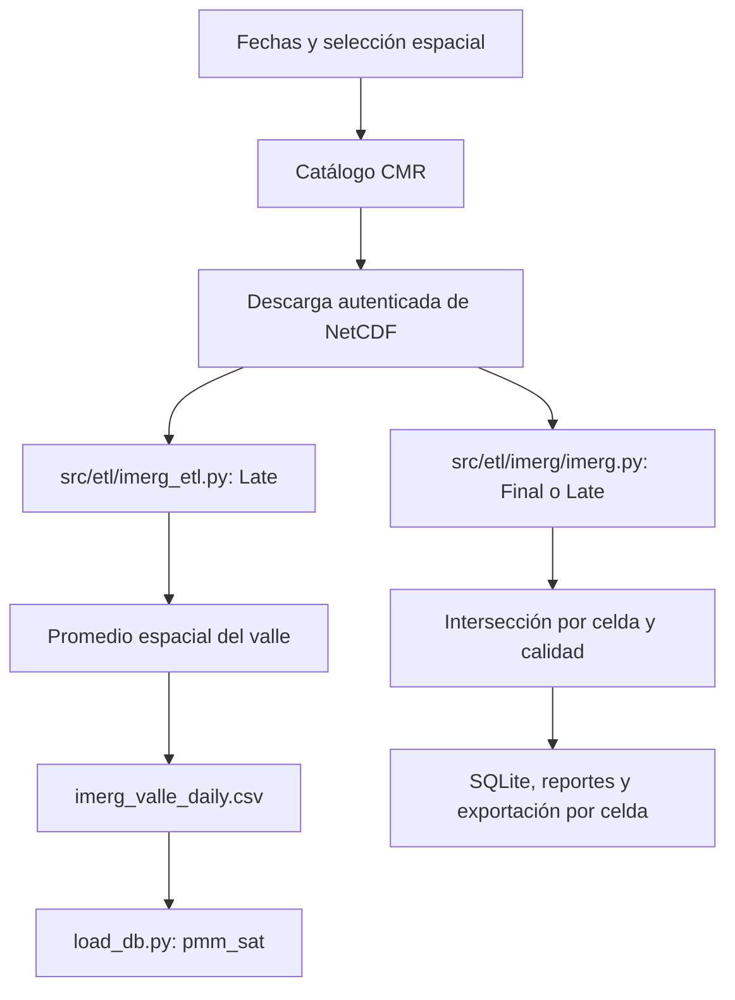

# GPM IMERG: precipitación satelital

## Fuente y propósito

NASA GPM IMERG proporciona estimaciones de precipitación en una malla de 0,1°. Se utilizan para describir lluvia, periodos secos y aportes de agua durante el ciclo de cultivo. El día del producto se mantiene en **UTC**.

- Histórico Final: `GPM_3IMERGDF`, colección 07.
- Ejecución Late: `GPM_3IMERGDL`, colección 07.
- Catálogo: `https://cmr.earthdata.nasa.gov/search/granules.json`.
- [Descripción IMERG](https://gpm.nasa.gov/data/imerg) y [guía detallada del programa independiente](../../src/etl/imerg/README.md).

## Flujo utilizado por el orquestador

[imerg_etl.py](../../src/etl/imerg_etl.py) consulta CMR mes a mes para la colección Late `C2723754859-GES_DISC`, filtra las fechas solicitadas y descarga archivos NetCDF. La selección espacial está definida en el script: oeste −66,40; sur −17,65; este −65,95; norte −17,15.

El filtro CMR localiza archivos que intersectan el área. La extracción selecciona centros de celdas dentro del rectángulo y promedia los valores válidos de `precipitation` para producir una serie del valle. El archivo diario ya contiene la variable diaria; el procesamiento toma su plano temporal único. Las descargas temporales se eliminan después de extraer los valores.

Configurar `EARTHDATA_TOKEN` en el entorno o en `.env` de la raíz según el lector del script. La descarga utiliza autorización Bearer. Las credenciales se gestionan fuera de los datos versionados.

## Ejecución

Desde la raíz, con el entorno Python del proyecto:

```bash
uv run python src/etl/imerg_etl.py --start 2016-01-01 --end 2025-12-31 --workers 3 --out data/imerg/imerg_valle_daily.csv
```

También puede ejecutarse `bash etl.sh imerg`. El script omite fechas que ya están en el CSV y añade las pendientes; las filas pueden aparecer en orden de finalización de los workers. Para un periodo reciente, pasar ese intervalo en `--start` y `--end`.

## Diccionario de la salida del valle

| Columna | Qué mide | Unidad / referencia |
|---|---|---|
| `fecha` | Día del archivo de precipitación | Fecha UTC, `YYYY-MM-DD` |
| `pmm_imerg` | Promedio de precipitación diaria de las celdas válidas seleccionadas | mm/día |
| `n_pixels` | Número de centros de celda seleccionados por la máscara espacial | Conteo |

El archivo `imerg_valle_daily.csv` es la entrada que [load_db.py](../../src/etl/load_db.py) relaciona por fecha y guarda como `climate_history.pmm_sat`. `pmm_sat` conserva la lluvia IMERG separada de `pmm`, que procede de POWER.

## Programa por celdas: catálogo, calidad y actualizaciones

[imerg.py](../../src/etl/imerg/imerg.py) ofrece comandos `catalog`, `download`, `process`, `report`, `export` y `update`, para Final y Late. Usa el área de [cochabamba-estudio.geojson](../../src/etl/imerg/areas/cochabamba-estudio.geojson), documentada en [areas/README.md](../../src/etl/imerg/areas/README.md). Es un rectángulo de estudio con procedencia GAMC.

Este flujo conserva las celdas que intersectan el polígono y registra en SQLite: fecha UTC, fuente, producto, revisión, ejecución, identificador y coordenadas de celda, fracción de intersección, variable, valor, unidad, calidad, fecha de descarga y nombre del archivo. La fracción se calcula en coordenadas geográficas. El CSV exportado tiene ese esquema por celda, distinto del CSV de tres columnas consumido por el cargador del valle.

Para usarlo, disponer de las dependencias de [requirements.txt](../../src/etl/imerg/requirements.txt) en el intérprete elegido; el acceso de descarga se realiza mediante Earthdata/earthaccess. Desde la raíz:

```bash
python src/etl/imerg/imerg.py catalog --start 2025-01-01 --end 2025-01-31 --run final --bbox -66.280703 -17.531190 -66.069520 -17.257306 --output /tmp/imerg-catalog.json
python src/etl/imerg/imerg.py download --manifest /tmp/imerg-catalog.json --folder /tmp/imerg-raw-final
python src/etl/imerg/imerg.py process --folder /tmp/imerg-raw-final --polygon src/etl/imerg/areas/cochabamba-estudio.geojson --database /tmp/imerg-rain.sqlite --run final
python src/etl/imerg/imerg.py report --database /tmp/imerg-rain.sqlite --start 2025-01-01 --end 2025-01-31 --output /tmp/imerg-coverage.json
python src/etl/imerg/imerg.py export --database /tmp/imerg-rain.sqlite --output /tmp/imerg-cells.csv
```

`update` reconsulta ventanas de Late (14 días) y Final (210 días), configurables con `--late-days` y `--final-days`. Conserva las ejecuciones separadas y prioriza Final válido en la vista de consulta de la misma revisión. El comando puede solicitar autenticación interactiva:

```bash
python src/etl/imerg/imerg.py update --root /tmp/imerg-updates --polygon src/etl/imerg/areas/cochabamba-estudio.geojson --database /tmp/imerg-rain.sqlite
```

## Flujo


