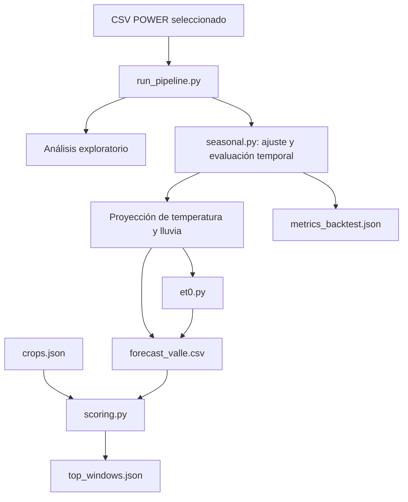

# Salidas del modelo y ventanas de siembra

## Propósito y entradas

Esta carpeta conserva proyecciones climáticas, métricas de evaluación y ventanas sugeridas por cultivo. El proceso utiliza el CSV POWER elegido con `--power` y el catálogo seleccionado con `--crops`. El diccionario de las entradas está en [power/README.md](../power/README.md) y [crops/README.md](../crops/README.md).

## Scripts y ejecución

| Script | Función |
|---|---|
| [run_pipeline.py](../../src/model/run_pipeline.py) | Coordina lectura, análisis exploratorio, evaluación temporal, proyección y puntuación |
| [seasonal.py](../../src/model/seasonal.py) | Ajusta una base estacional de Fourier por mínimos cuadrados y calcula MAE/RMSE |
| [et0.py](../../src/model/et0.py) | Calcula evapotranspiración de referencia Hargreaves y radiación extraterrestre |
| [scoring.py](../../src/model/scoring.py) | Compara cada ventana con las condiciones del cultivo y selecciona hasta tres alternativas |

Desde la raíz, con el entorno del proyecto:

```bash
uv run python -m src.model.run_pipeline --power data/power/D1_tunari_daily.csv --crops data/crops/crops.json --out data/model --eda docs/EDA.md --horizon 365
```

El proceso escribe archivos en `--out` y el análisis exploratorio en `--eda`. El punto de referencia temporal está definido en el script. La evaluación utiliza el periodo 2024–2025 y la proyección tiene el horizonte elegido con `--horizon`. Ejecutar de nuevo sustituye las salidas de esas rutas.

## Datos generados

| Archivo | Contenido |
|---|---|
| `forecast_valle.csv` | Una fila por día proyectado con temperatura, precipitación, ET₀ y bandas |
| `metrics_backtest.json` | Periodo de evaluación, MAE/RMSE por variable y resumen del análisis exploratorio |
| `top_windows.json` | Objeto por cultivo con hasta tres ventanas, puntaje, confianza y componentes |
| `docs/EDA.md` | Documento de análisis de las series de entrada, generado fuera de esta carpeta |

### Diccionario de la proyección

| Columna | Qué representa | Unidad |
|---|---|---|
| `fecha` | Fecha proyectada | `YYYY-MM-DD` |
| `tmean`, `tmin`, `tmax` | Temperatura media, mínima y máxima proyectadas | °C |
| `pmm` | Precipitación diaria proyectada | mm/día |
| `et0` | Evapotranspiración de referencia calculada con temperaturas proyectadas | mm/día |
| `tmean_baja`, `tmean_alta` | Extremos de la banda para temperatura media | °C |
| `tmin_baja`, `tmin_alta` | Extremos de la banda para temperatura mínima | °C |
| `pmm_baja`, `pmm_alta` | Extremos de la banda de precipitación | mm/día |
| `et0_baja`, `et0_alta` | Extremos de la banda derivada para ET₀ | mm/día |

Las métricas MAE y RMSE se expresan en la unidad de la variable evaluada. Las bandas y la confianza se calculan con las reglas del programa; son resultados derivados del modelo.

### Diccionario de ventanas

| Campo | Significado |
|---|---|
| Identificador superior | `id` del catálogo de cultivos |
| `inicio`, `fin` | Fechas de la ventana de ciclo evaluada |
| `score` | Puntaje combinado de aptitud, escala 0–100 |
| `confianza` | Indicador heurístico calculado según posición en el horizonte |
| `detalle.temp`, `detalle.agua`, `detalle.helada` | Componentes normalizados del puntaje |
| `detalle.erosion` | Factor territorial utilizado por el evaluador |
| `detalle.deficit_mm` | Suma del déficit hídrico calculado durante la ventana, en mm |
| `detalle.frost_days` | Conteo de días clasificados por el umbral térmico del evaluador |

La duración utilizada es la media de `ciclo_dias`. El evaluador recorre ventanas, combina los componentes definidos en `scoring.py` y selecciona alternativas con separación mínima de inicio. Los datos de esta carpeta son salidas calculadas; las mediciones de origen permanecen en las carpetas de sus fuentes.

## Flujo


