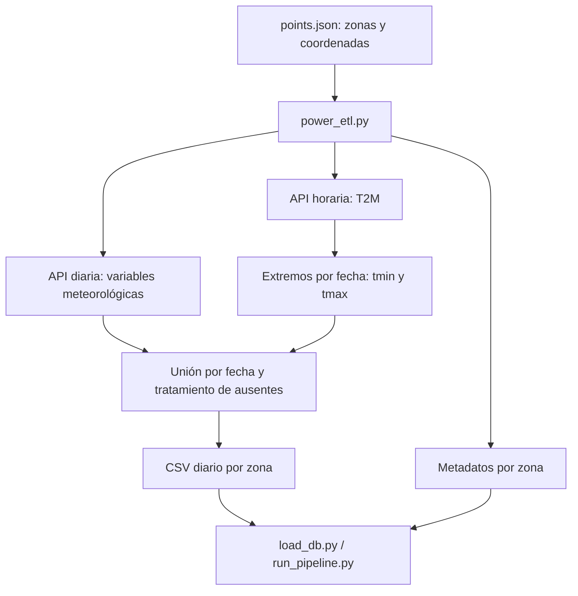

# NASA POWER: clima por zona

## Fuente y propósito

Serie meteorológica para los puntos de Cercado definidos en [points.json](../../src/etl/points.json). Aporta temperatura, humedad del aire, viento, presión, lluvia y radiación para caracterizar campañas y calcular indicadores agroclimáticos.

- Proveedor: NASA POWER; comunidad `ag`.
- API: `https://power.larc.nasa.gov/api/temporal/daily/point` y `https://power.larc.nasa.gov/api/temporal/hourly/point`.
- Acceso público, sin token.
- [Documentación diaria](https://power.larc.nasa.gov/docs/services/api/temporal/daily/) y [metodología](https://power.larc.nasa.gov/docs/methodology/data/sources_meteorology/).

## Scripts y consulta

[power_etl.py](../../src/etl/power_etl.py) lee la lista de puntos (`id`, `lat`, `lon`, `nombre`) y consulta cada zona por bloques anuales. Envía coordenadas, `parameters`, `community=ag`, `format=JSON`, `start` y `end` en formato `YYYYMMDD`.

`download_daily()` obtiene las variables diarias; `download_hourly_t2m()` obtiene `T2M` horario. `derive_minmax()` agrupa las horas por fecha y calcula sus extremos. `write_zone()` une ambas series por fecha y escribe los resultados ordenados. El valor de relleno `-999` se convierte en ausente.

Las peticiones actuales no fijan `time-standard`: la convención del servicio POWER es tiempo solar local (LST). Conservar esa referencia al relacionar las fechas con otras fuentes. Cada bloque va desde el 1 de enero del año al 1 de enero siguiente; la unión por fecha resuelve los extremos compartidos.

## Ejecución

Desde la raíz del repositorio, con Python 3.13 y el entorno del proyecto:

```bash
uv run python src/etl/power_etl.py --points src/etl/points.json --start 1984 --end 2025 --hstart 2010 --hend 2025 --out data/power
```

`--start/--end` controlan los años diarios; `--hstart/--hend`, los horarios. Para trabajar en una salida separada se puede cambiar `--out`. Cada ejecución descarga el rango indicado y vuelve a escribir los CSV y metadatos de los puntos elegidos. `bash etl.sh power` ejecuta el preset del orquestador.

## Datos guardados

| Columna CSV | Variable o cálculo | Qué mide | Unidad |
|---|---|---|---|
| `fecha` | Fecha de la serie | Día al que corresponde la observación | `YYYY-MM-DD` |
| `tmean` | `T2M` diario | Temperatura media del aire a 2 m | °C |
| `tmin` | Mínimo de `T2M` horario por fecha | Temperatura mínima de las horas disponibles | °C |
| `tmax` | Máximo de `T2M` horario por fecha | Temperatura máxima de las horas disponibles | °C |
| `t2mdew` | `T2MDEW` | Temperatura de punto de rocío a 2 m | °C |
| `rh` | `RH2M` | Humedad relativa del aire a 2 m | % |
| `ws` | `WS2M` | Velocidad del viento a 2 m | m/s |
| `ps` | `PS` | Presión atmosférica superficial | kPa |
| `pmm` | `PRECTOTCORR` | Precipitación corregida del día; la solicitud usa `PRECTOT` | mm/día |
| `sw` | `ALLSKY_SFC_SW_DWN` | Energía solar de onda corta descendente con nubosidad | MJ/m²/día |
| `sw_clear` | `CLRSKY_SFC_SW_DWN` | Energía de onda corta descendente para cielo despejado | MJ/m²/día |
| `lw` | `ALLSKY_SFC_LW_DWN` | Energía de onda larga descendente con nubosidad | MJ/m²/día |

`TS` se solicita en la consulta diaria como temperatura de superficie; las columnas exportadas son las de la tabla anterior.

- `{zone_id}_daily.csv`: una fila por fecha; una celda vacía representa un valor ausente.
- `{zone_id}_meta.json`: `zone_id`, `nombre`, `lat`, `lon`, `elev_m`, `start`, `end`, `hstart`, `hend` y `filas`. La elevación procede de la geometría devuelta por POWER.
- Los archivos conservados se generaron para diez zonas; el rango horario se identifica en cada metadato.

## Uso posterior

[load_db.py](../../src/etl/load_db.py) incorpora las series a `climate_history`. [run_pipeline.py](../../src/model/run_pipeline.py) recibe un CSV POWER mediante `--power`. Las coordenadas son puntos de consulta sobre la resolución de origen del producto; el contexto de cada zona se complementa con GAMC y relieve.

## Flujo


