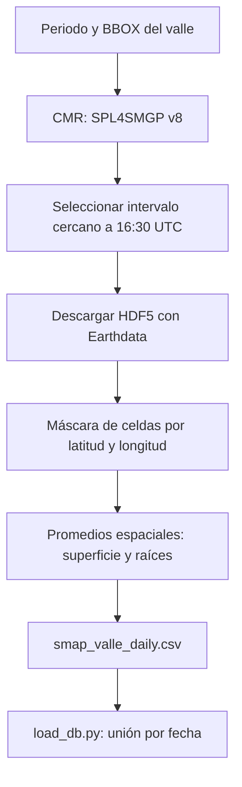

# SMAP L4: humedad del suelo

## Fuente y propósito

SMAP L4 `SPL4SMGP`, versión 8, combina observaciones y un modelo terrestre para estimar humedad superficial y radicular. El producto tiene malla de 9 km e intervalos de tres horas. [Ficha y acceso NASA NSIDC](https://nsidc.org/data/spl4smgp/versions/8).

## Script y consulta

[smap_etl.py](../../src/etl/smap_etl.py) consulta el catálogo CMR (`https://cmr.earthdata.nasa.gov/search/granules.json`) por mes, con colección `C3480440870-NSIDC_CPRD`, intervalo temporal y BBOX `-66.40,-17.65,-65.95,-17.15` (oeste, sur, este, norte).

Para cada fecha, selecciona el archivo cuya hora es más cercana a **16:30 UTC** (12:30 en Cochabamba). Descarga el HDF5, selecciona las celdas del rectángulo usando `cell_lat` y `cell_lon`, y calcula el promedio espacial de ambas humedades. Cada fila representa el intervalo elegido de ese día. Después elimina el archivo temporal.

El lector de autenticación utiliza `EARTHDATA_TOKEN` en `.env` de la raíz. El procesamiento usa `h5py` y `numpy`.

## Ejecución y reanudación

Desde la raíz, con el entorno del proyecto:

```bash
uv run python src/etl/smap_etl.py --start 2015-04-01 --end 2025-12-31 --workers 5 --out data/smap/smap_valle_daily.csv
```

`bash etl.sh smap` ejecuta el mismo preset. `--tmp-dir` permite elegir el directorio temporal de descarga. El script lee las fechas presentes en el CSV y procesa las pendientes dentro del rango solicitado; las filas se añaden al finalizar cada worker. Cambiar `--start/--end` permite consultar otro periodo.

## Datos guardados

| Columna | Variable HDF5 / significado | Unidad |
|---|---|---|
| `fecha` | Fecha UTC del archivo seleccionado | `YYYY-MM-DD` |
| `sm_surface` | `Geophysical_Data/sm_surface`: promedio espacial de humedad volumétrica superficial | m³/m³ |
| `sm_root` | `Geophysical_Data/sm_rootzone`: promedio espacial de humedad volumétrica de raíces | m³/m³ |
| `n_pixels` | Cantidad de celdas cuya coordenada cumple la selección espacial | Conteo |

La humedad volumétrica expresa volumen de agua por volumen de suelo: por ejemplo, 0,20 m³/m³ equivale a una fracción de 20 %. Es diferente de la humedad relativa del aire (`rh`, POWER).

La salida `smap_valle_daily.csv` se une por fecha en [load_db.py](../../src/etl/load_db.py) y alimenta `climate_history.sm_surface` y `climate_history.sm_root`. La serie resume el área del valle; al consumirla debe conservarse su agregación espacial y la hora del intervalo seleccionado.

## Flujo


