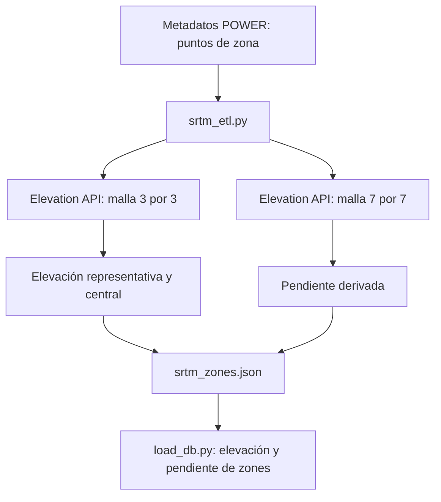

# Relieve: elevación y pendiente por zona

## Fuente y propósito

La carpeta `srtm/` conserva el nombre utilizado por el proyecto para sus datos de relieve. El script actual consulta **Open-Meteo Elevation API**: `https://api.open-meteo.com/v1/elevation`. [Documentación del proveedor](https://open-meteo.com/en/docs/elevation-api).

La elevación y la pendiente describen el contexto topográfico de cada punto. También se genera una comparación con la referencia de 2750 m utilizada por el proyecto.

## Script y consulta

[srtm_etl.py](../../src/etl/srtm_etl.py) lee las zonas de `data/power/*_meta.json`. Por zona envía listas de latitudes y longitudes al endpoint de elevación y obtiene:

- Una malla de 3 × 3 puntos con paso de 0,0003° para resumir la elevación.
- Una malla de 7 × 7 puntos con paso de 0,0015° para calcular pendiente mediante diferencias de elevación entre bordes.

La elevación representativa es un estadístico bajo de la malla 3 × 3: ordena sus nueve alturas y selecciona el índice entero `0.15 × (n − 1)`. Conserva además la altura del centro. La pendiente se expresa en grados mediante la magnitud del gradiente y la arcotangente.

## Ejecución

Desde la raíz, con el entorno Python y los metadatos POWER disponibles:

```bash
uv run python src/etl/srtm_etl.py --out data/srtm/srtm_zones.json
```

`bash etl.sh srtm` ejecuta el mismo paso. No utiliza clave de API en la petición. El script reintenta cada zona y guarda el JSON progresivamente. Las zonas presentes se omiten; para conservar una captura y generar otra, cambiar `--out`.

## Datos guardados

El archivo `srtm_zones.json` está indexado por identificador de zona:

| Campo | Qué mide | Unidad / tipo |
|---|---|---|
| `lat`, `lon` | Coordenada del punto de referencia | Grados, WGS84 |
| `elev_m` | Elevación representativa seleccionada de la malla 3 × 3 | m |
| `elev_centro_m` | Elevación del centro de la malla | m |
| `slope_deg` | Pendiente derivada de la malla de mayor extensión | Grados |
| `grid_m` | Las nueve elevaciones de la malla 3 × 3 | Matriz de metros |
| `sobre_cota_2750` | Resultado de comparar `elev_m >= 2750` | Booleano |

[load_db.py](../../src/etl/load_db.py) relaciona cada registro por zona y utiliza `elev_m`, `slope_deg` y la comparación de altura en la tabla `zones`. Son atributos estáticos de contexto, no una serie meteorológica diaria.

## Flujo


