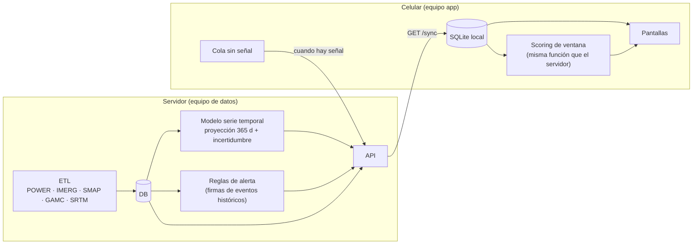

# Choclito — Contrato de API (para el equipo de datos)

Versión del contrato: **v1.1 (borrador)** · Fecha: 2026-11-14

Este documento dice **qué datos necesita la app y en qué forma**. Está alineado con:

- [`BACKLOG.md`](BACKLOG.md): arquitectura offline-first, endpoints `/zones`, `/crops`, `/zones/{id}/forecast`, `/sync`, scoring en el dispositivo.
- [`data/crops/crops.json`](../data/crops/crops.json): catálogo de 13 cultivos y variables comunes.
- [`src/etl/imerg/README.md`](../src/etl/imerg/README.md): lluvia diaria GPM IMERG 2016–2025.
- [`FLUJO-APP.md`](FLUJO-APP.md): pantallas y flujos de la app (mockups).

---

## 0. Arquitectura y reparto de trabajo



| Lo calcula el **servidor** | Lo calcula el **celular** |
|---|---|
| Proyección diaria 365 d por zona, con banda de incertidumbre | Días buenos / con cuidado / malos para sembrar (scoring de ventana, tarea 2.4) |
| Pronóstico corto (14 días) para Hoy y Calendario (**ver §12, pendiente**) | Palabras para el clima ("lluvia débil", "Helada") con las reglas de §2.4 |
| Alertas por firma de eventos históricos | Recordatorios de cosecha (7 días, 1 día, mismo día, +1 día) |
| Catálogo de cultivos y de rotaciones con su evidencia | Orden de las rotaciones según objetivo y época |
| Mapa de reportes de la zona (agregado y anónimo) | Mis cultivos, mis planes, mi parcela (quedan en el celular) |

---

## 1. Reglas generales

| Tema | Regla |
|---|---|
| Base | `https://api.choclito.example/v1` (dominio por definir) |
| Rutas | En inglés, como el backlog: `/zones`, `/crops`, `/sync`… |
| Campos | `snake_case` en español, como `crops.json` (`ciclo_dias`, `tolerancia`…). Variables de clima con los nombres de `crops.json`: `tmin`, `tmax`, `tmean`, `pmm`, `rh`, `sw`, `ws`, `sm_surface`, `sm_root`. |
| Fechas | ISO 8601. Día civil boliviano (America/La_Paz, UTC−4), **salvo IMERG**, que viene en día UTC (ver §5). |
| Coordenadas | WGS84, orden GeoJSON **longitud, latitud**. |
| Unidades | °C · mm/día · % · m/s · m³/m³ · m. Radiación `sw` en **MJ/m²/día**, como sale de POWER en `data/power/` (el README de cultivos dice W/m²: unificar). |
| Textos | La API devuelve **códigos**, no frases. La app traduce a español y quechua. |
| Fuente | Todo dato derivado lleva `fuente` (códigos de §10). |
| Frescura | Toda respuesta lleva `actualizado_en`. La app muestra "actualizado 16 nov, 6:00". |
| Confianza | Proyecciones y recomendaciones llevan `confianza`: `alta` · `media` · `baja`. |
| Peso | `/sync` ≤ **500 KB** (backlog 3.3). Otros endpoints ≤ 50 KB. gzip siempre. |
| Caché | `ETag` + `sync_version` para descargar solo cambios. |
| Privacidad | La parcela y los cultivos del agricultor quedan en el celular. Los reportes van al mapa **sin nombre**. |

---

## 2. Endpoints del backlog

### 2.1 `GET /zones`
Zonas agrícolas del Cercado (grid de puntos, backlog 0.2 y 1.4). Los ids son los del ETL de POWER: `D9_itocta`, `D15_tamborada`, `D3_molle`… (ver `data/power/*_meta.json`). La app ubica al agricultor en la zona más cercana a su GPS.

```json
{
  "actualizado_en": "2026-11-14T06:00:00-04:00",
  "zones": [
    { "id": "D9_itocta", "nombre": "Itocta", "comuna": "ITOCTA", "distrito": 9,
      "lat": -17.4611, "lon": -66.2185, "elev_m": 2590, "pendiente": 2.1,
      "es_agricola": true, "cerca_drenaje": 140, "altitud_alta": false }
  ],
  "fuente": ["gamc_wms", "srtm"]
}
```

### 2.2 `GET /crops`
Devuelve `data/crops/crops.json` tal cual (versión, variables y lista `crops`). Ver el esquema en [`data/crops/README.md`](../data/crops/README.md).

**Lo que la app necesita además** (pedir que se agregue al catálogo):

| Campo nuevo | Para qué pantalla | Ejemplo |
|---|---|---|
| `kc` `{inicial, medio, final}` | Riego (FAO-56) | `{ "inicial": 0.3, "medio": 1.2, "final": 0.35 }` |
| `granizo_sens` `alta`·`media`·`baja` | Riesgos por mes en Mi cultivo | `"alta"` |
| `etapas` `[[dia, codigo]]` | Barra de avance y "Calendario de tu cultivo" | `[[0,"siembra"],[21,"creciendo"],[80,"floracion"],[100,"cosecha"]]` |
| `cosechas_cada_dias` (perennes) | Alfalfa: próximas cosechas | `42` |
| `foto` | Sembrar, Mi cultivo | `"img/papa.webp"` (ya hay fotos con licencia en `mockups/img/`) |

**Ids:** la app usa los del catálogo. Equivalencias con los mockups:

| Mockup | Catálogo | Nota |
|---|---|---|
| `maiz` (maíz choclo) | `choclo` | Cambiar en la app |
| `forraje` (maíz forraje) | — | **Falta en el catálogo**: pedir `maiz_forraje` (muy común en Itocta) |
| `cebolla`, `zanahoria` | `hortalizas` | La app las muestra separadas; pedir si se pueden separar |
| `papa`, `haba`, `avena`, `alfalfa`, `lechuga` | igual | |

### 2.3 `GET /zones/{zone_id}/forecast?anio=2027`
Proyección diaria 365 d (backlog 2.2 y 3.2). Alimenta: **Calendario → próximos meses**, **Elegir fecha de siembra** (scoring) y **¿Qué sembrar después?**.

```json
{
  "zone_id": "D9_itocta",
  "anio": 2027,
  "creado_en": "2026-11-10T03:00:00-04:00",
  "modelo": { "tipo": "fourier_tendencia", "backtest": { "periodo": "2024-2025", "mae": { "tmin": 1.4, "pmm": 2.9 } } },
  "dias": [
    { "fecha": "2027-01-15", "tmin": 10.2, "tmax": 24.6, "tmean": 17.1, "pmm": 4.8, "et0": 3.5,
      "rh": 71, "sw": 21.6, "ws": 2.1, "sm_surface": 0.27, "sm_root": 0.30,
      "incert_min": { "tmin": 8.9, "pmm": 0.0 }, "incert_max": { "tmin": 11.6, "pmm": 13.0 } }
  ],
  "fuente": ["nasa_power", "nasa_imerg", "nasa_smap"]
}
```
- `incert_min` / `incert_max`: como mínimo para `tmin` y `pmm`. La app los usa para la `confianza` del scoring (helada) y para marcar "puede cambiar".
- SMAP es un solo valor para el valle (píxel de 9 km): repetir el mismo valor en todas las zonas y marcarlo con `fuente`.

### 2.4 `GET /sync?zone_id=&desde_version=`
Paquete para el celular (backlog 3.3). El celular lo guarda en SQLite y funciona sin internet.

```json
{
  "sync_version": 42,
  "hash": "sha256:…",
  "zone": { "...": "objeto de /zones" },
  "crops": { "...": "objeto de /crops" },
  "forecast": { "...": "objeto de /zones/{id}/forecast" },
  "corto_plazo": { "...": "objeto de §3.1" },
  "climatologia": { "...": "objeto de §3.2" },
  "alertas": [ "...objetos de §6" ],
  "rotaciones": { "...": "objeto de §4" },
  "represa": { "...": "objeto de §3.3" },
  "historial_zona": [ "...objetos de §7.2" ]
}
```
Con `desde_version`, devolver solo lo que cambió.

#### Reglas de interpretación que la app aplica sobre estos datos

| Concepto | Regla |
|---|---|
| Helada (día) | `tmin < 0 °C` (igual que `crops.json`) |
| Lluvia en palabras | `pmm = 0` sin lluvia · `< 4` débil · `< 15` moderada · `≥ 15` fuerte |
| Icono del día (prioridad) | granizo > helada > lluvia > nublado > sol |
| Época | seca: abril–septiembre · lluvias: octubre–marzo |
| Scoring de ventana | El de `data/crops/README.md` ("Reglas de scoring"): `score_window()` en `src/model/scoring.py` devuelve `score` (0–100), `veredicto` (`bueno` ≥ 70 verde · `con_cuidado` ≥ 40 amarillo · `malo` < 40 rojo; umbrales configurables), `confianza` (0.4–0.9), `motivos` (códigos: `temp_fuera_rango`, `deficit_agua`, `heladas`, `erosion_riesgo`) y `detalle`. Contrato de portabilidad para la app: `data/model/test_vectors.json` (issue #37 [T12a]). |

---

## 3. Endpoints que faltan para las pantallas

### 3.1 `GET /zones/{zone_id}/weather?dias=14`
**Pronóstico corto día por día.** Pantallas: **Hoy**, **Calendario → próximas semanas**, alertas de 1–2 semanas. La proyección estacional (§2.3) no sirve para decir "helada el sábado": hace falta un pronóstico meteorológico. **Pendiente de decidir la fuente** (§12).

```json
{
  "zone_id": "D9_itocta",
  "actualizado_en": "2026-11-16T06:00:00-04:00",
  "dias": [
    { "fecha": "2026-11-21", "tmin": -2, "tmax": 24, "pmm": 0, "granizo": false, "confianza": "alta" },
    { "fecha": "2026-11-26", "tmin": 10, "tmax": 23, "pmm": 8, "granizo": true, "confianza": "media" }
  ],
  "fuente": ["nasa_geos"]
}
```
La app muestra 4 semanas: días 1–14 de aquí y días 15–28 de la proyección (§2.3), marcados "más lejos, puede cambiar".
- Si el último dato tiene más de 24 h, `desactualizado: true`. Sin datos todavía: `dias: []`, `actualizado_en: null` y `desactualizado: true`.

### 3.2 `GET /zones/{zone_id}/climatology`
**Clima típico por mes** (30 años, POWER 1984+ y IMERG 2016+). Pantallas: **Calendario → próximos meses**, **Mi cultivo** (riesgos por mes).

```json
{
  "zone_id": "D9_itocta",
  "periodo": { "power": "1995-2024", "imerg": "2016-2025" },
  "meses": [
    { "mes": 1, "pmm_total": 118, "tmin": 10.4, "tmax": 24.8,
      "p_helada": 0.0, "p_granizo": 0.35, "p_desborde": 0.30, "p_poca_agua": 0.05 },
    { "mes": 7, "pmm_total": 2, "tmin": -1.6, "tmax": 22.1,
      "p_helada": 0.85, "p_granizo": 0.0, "p_desborde": 0.0, "p_poca_agua": 0.40 }
  ],
  "fuente": ["nasa_power", "nasa_imerg", "eventos_historicos"]
}
```
`p_*` = fracción de años con el evento ese mes. La app marca el riesgo del mes si `p ≥ 0.2`.

### 3.3 `GET /reservoirs/la-angostura`
Pantallas: **Hoy** (tira), **Avisos**, **Rotaciones**.
```json
{ "actualizado_en": "2026-11-15T18:00:00-04:00", "nivel_pct": 34, "volumen_hm3": 25.5,
  "estado": "bajo", "fuente": ["riego_n1"] }
```
`estado`: `normal` · `bajo` (< 40 %) · `critico` (< 20 %).

### 3.4 `GET /zones/{zone_id}/history?desde=&hasta=`
**Clima medido.** Pantalla: **Calendario → Ver semanas pasadas**. Sale de `rain.sqlite` (IMERG) y de POWER.

```json
{
  "dias": [
    { "fecha_utc": "2026-11-12", "pmm": 3.2, "pmm_producto": "late", "pmm_revision": "V07B",
      "pmm_calidad": { "intervalos_validos": 48 },
      "fecha": "2026-11-12", "tmin": 6.1, "tmax": 27.4 }
  ],
  "fuente": ["nasa_imerg", "nasa_power"]
}
```
- IMERG: día **UTC**, celdas 0.1° (~11 km), `final` preferido sobre `late` (vista `preferred_rain`). Agregar las celdas de la zona por `area_fraction`.
- Si un día tiene < 48 intervalos válidos, mandar igual con `pmm_calidad` para que la app lo marque.

---

## 4. Rotaciones

Pantalla: **¿Qué sembrar después?** (backlog 2.6). Cumple el reto: **al menos 3 estrategias, incluida la actual**, cada una con por qué, evidencia, beneficios, lo que falta saber y riesgos.

Viaja dentro de `/sync` (corte de MVP: tabla estática). La app las ordena según el objetivo y la época.

```json
{
  "actualizado_en": "2026-11-14T06:00:00-04:00",
  "rotaciones": [
    { "id": "choclo-haba", "secuencia": ["choclo", "haba"],
      "puntaje": { "agua": 1, "tierra": 3, "forraje": 1, "vender": 3 },
      "etiquetas": [["abona_tierra", "bien"], ["vende_haba", "bien"], ["mas_riego", "mal"]],
      "por_que": "fija_nitrogeno",
      "bueno": ["tierra_fertil", "menos_gusano", "vende_haba_verde"],
      "riesgos": ["helada_julio_flor", "riego_invierno"],
      "falta_saber": ["precio_haba"],
      "evidencia": [
        { "codigo": "heladas_may_ago", "fuente": "nasa_power" },
        { "codigo": "poca_lluvia_abr_sep", "fuente": "nasa_imerg" },
        { "codigo": "angostura_baja", "fuente": "riego_n1" }
      ],
      "confianza": "media" },
    { "id": "choclo-sin_cultivo", "secuencia": ["choclo", null], "actual_tipica": true,
      "meses_sin_cultivo": 6, "...": "mismos campos" }
  ]
}
```
- Mínimo **3 alternativas por cultivo de partida** (choclo, papa, haba…) + la opción sin rotar. El backlog cita como actual típica papa → trigo → maíz.
- `puntaje`: 1 (peor) a 3 (mejor) por objetivo `agua` · `tierra` · `forraje` · `vender`. Base sugerida: `agua.demanda`, `fix_n`, `erosion_sens`, `mercado` de `crops.json`.
- `etiquetas`: `[codigo, "bien" | "mal" | "neutro"]`, máximo 3.
- Las fechas de cada plan las calcula la app: siembra siguiente = cosecha + ~1 mes; duración = `ciclo_dias` del catálogo.

---

## 5. Notas sobre los datos (para no confundir a la app)

| Dataset | Cuidado |
|---|---|
| IMERG | Día UTC, no civil. 0.1° no es una parcela. Final y Late separados. Lluvia 0 no es dato faltante. |
| SMAP L4 | 9 km: un valor para todo el valle. Excluir 2026-05-14 → 2026-07-28 (reprocesamiento). |
| POWER | 0.5°: varias zonas comparten celda; la diferencia entre zonas viene de SRTM y GAMC. |
| GAMC WMS | Rate limit 10–15 s por petición: todo precalculado, nunca en tiempo real desde la app. |

---

## 6. Alertas

### `GET /zones/{zone_id}/alerts`
Pantalla: **Avisos → Alertas** y franja de **Hoy**. Reglas por firma de eventos históricos (backlog 2.5) + pronóstico corto.

```json
{
  "actualizado_en": "2026-11-16T06:00:00-04:00",
  "alertas": [
    { "id": "al-1", "tipo": "helada", "fecha_evento": "2026-11-21", "momento": "madrugada",
      "valor": { "tmin": -2 }, "confianza": "alta", "volver_a_avisar": "2026-11-20",
      "regla": { "id": "helada-firma-1", "similitud": 0.82, "eventos_parecidos": ["2019-06-12", "2021-07-03"] } },
    { "id": "al-3", "tipo": "represa_baja", "valor": { "nivel_pct": 34 } }
  ]
}
```
- `tipo`: `helada` · `granizo` · `lluvia_fuerte` · `desborde` · `sequia` · `represa_baja` · `temporada`
- La notificación sale a las **6:00**, 7 días antes (si `confianza` ≠ `baja`) y 1 día antes.
- Los **recordatorios de cosecha** no vienen de la API: el celular los calcula con las fechas de Mis cultivos.

---

## 7. Lo que manda el celular

### 7.1 `POST /reports`
Pantalla: **Mi zona → Avisar algo → Enviar aviso** (backlog 4.4: aviso a usuarios cercanos). Acepta envíos atrasados.
```
Idempotency-Key: <uuid generado en el celular>
Content-Type: multipart/form-data
```
| Campo | Tipo | Nota |
|---|---|---|
| `tipo` | texto | `sin_agua` · `helada` · `granizo` · `inundacion` · `plaga` |
| `zone_id` | texto | |
| `lat`, `lon` | número | Redondeado a 3 decimales (~100 m) por privacidad |
| `ocurrido_en` | fecha-hora | Hora del celular, no del envío |
| `foto` | archivo opcional | JPEG ≤ 300 KB |
| `audio` | archivo opcional | ≤ 60 s |

Respuesta `201`: `{ "id": "rep-551", "vecinos_mismo_tipo_semana": 7 }`

### 7.2 `GET /zones/{zone_id}/map` y `historial`
Pantalla: **Mi zona**.
```json
{
  "actualizado_en": "2026-11-16T06:00:00-04:00",
  "resumen": { "sin_agua_vecinos": 8, "periodo_dias": 7, "direccion": "este" },
  "capas": {
    "sin_agua": { "type": "FeatureCollection", "features": [] },
    "inundable": { "type": "FeatureCollection", "features": [] }
  },
  "historial": [
    { "fecha": "2024-03-10", "tipo": "inundacion", "lugar": "canal_valverde", "fuente": "eventos_historicos" },
    { "fecha": "2024-07-04", "tipo": "represa_baja", "valor": { "nivel_pct": 18 } }
  ]
}
```
- `sin_agua`: celdas con **≥ 3 reportes** en 7 días (nunca un reporte suelto ni datos personales).
- `inundable`: capa de drenaje GAMC (backlog G3) + eventos históricos.

### 7.3 `POST /feedback`
Pantalla: **¿Cómo salió tu cosecha?** (backlog 4.5). Es la única fuente de "etiquetas" de éxito para validar el modelo.
Encabezado obligatorio `Idempotency-Key` (generado en el celular). Respuestas: `201 {"id"}`; `409 {"id"}` con el id original si la clave ya se usó; `400` dato inválido; `404` `zone_not_found` / `crop_not_found`.
```json
{ "zone_id": "D9_itocta", "crop_id": "haba", "siembra": "2026-07-15",
  "cosecha": "2026-11-16", "resultado": "buena" }
```
`resultado`: `buena` · `regular` · `mala`. Si el agricultor respondió "Todavía no", no se envía nada.

### 7.4 Elección de rotación (opcional)
`POST /plans` `{ "zone_id": "D9_itocta", "rotacion_id": "choclo-haba", "siembra": "2027-04-05" }`. Solo para estadística de la zona: el plan vive en el celular. Mismo encabezado `Idempotency-Key` y mismas respuestas que `/feedback`.

---

## 8. Errores

```json
{ "error": { "codigo": "zone_not_found", "mensaje_tecnico": "zone_id D99_x no existe" } }
```
| HTTP | Cuándo |
|---|---|
| 400 | Parámetro inválido |
| 404 | No existe |
| 409 | `Idempotency-Key` repetida: devolver el reporte original |
| 503 | Fuente caída: devolver el último dato válido con `"desactualizado": true` |

---

## 9. Pantalla → datos

| Pantalla | Datos |
|---|---|
| Paso 1 · Ubicar parcela | `/zones` (+ mapa base) |
| Paso 2 · Tu parcela | Solo en el celular (fuente de agua, objetivo) |
| Hoy | `weather` (día 1), `alerts`, `reservoirs`, mis cultivos (local) |
| Calendario | `weather` + `forecast` (semanas), `history` (pasadas), `climatology` (meses), mis cultivos (local) |
| Sembrar / Elegir fecha | `crops` + `forecast` → scoring en el celular |
| ¿Qué sembrar después? | `rotaciones` (en `/sync`) + `crops` + época |
| Mi zona | `map`, `historial`, `POST /reports` |
| Avisos | `alerts` + recordatorios locales |

---

## 10. Códigos de fuente

| Código | Dataset |
|---|---|
| `nasa_power` | NASA POWER diario 1984+ (T2M, PRECTOT, RH2M, WS2M, ALLSKY_SFC_SW_DWN) |
| `nasa_imerg` | GPM IMERG V07 diario, Final y Late, 2016+ |
| `nasa_smap` | SMAP L4 SPL4SMGP v8, 2015+ |
| `nasa_geos` | GEOS-FP (pronóstico corto, si se elige, §12) |
| `srtm` | Open-Meteo Elevation (DEM global ~30 m; el servidor SRTM original dejó de responder) |
| `gamc_wms` | GAMC WMS (periurbanos, distritos, drenaje) |
| `riego_n1` | Asociación de Usuarios del Sistema de Riego N°1 La Angostura |
| `eventos_historicos` | Tabla `events` (backlog 1.7) |
| `catalogo_cultivos` | `data/crops/crops.json` |
| `reportes` | Reportes de agricultores |

---

## 11. Lo que pedimos al equipo de datos

1. `/zones`, `/crops`, `/zones/{id}/forecast` y `/sync` tal como dice el backlog.
2. **Pronóstico corto 14 días** (§3.1). Sin él no hay "helada el sábado" ni Hoy confiable.
3. **Climatología mensual** con probabilidades de helada, granizo, desborde y poca agua (§3.2).
4. Campos extra en `crops.json` (§2.2) y el cultivo `maiz_forraje`.
5. **Tabla de rotaciones**: mínimo 3 por cultivo de partida, con evidencia (§4).
6. Nivel de La Angostura (§3.3), aunque sea cargado a mano una vez por semana.
7. Validación: comparar los resultados de `POST /feedback` con el score que se dio a esa ventana.

## 12. Pendiente de decidir

| Tema | Opciones |
|---|---|
| Pronóstico corto (14 días) | NASA GEOS-FP · SENAMHI · otro servicio meteorológico. Hoy la app lo necesita y el backlog no lo cubre. |
| Fuente del granizo | SENAMHI · prensa (eventos históricos) · proxy por convección |
| Umbrales de scoring para verde / rojo | 70 / 40 propuesto; validar con backtest |
| Polígonos de parcelas | No hay. v1: la parcela es un punto GPS en el celular; el mapa de Paso 1 usa imagen base |
| Precios de mercado | Sin fuente: objetivo `vender` queda con `falta_saber` |
| Autenticación | Token por dispositivo, sin cuenta con correo |
