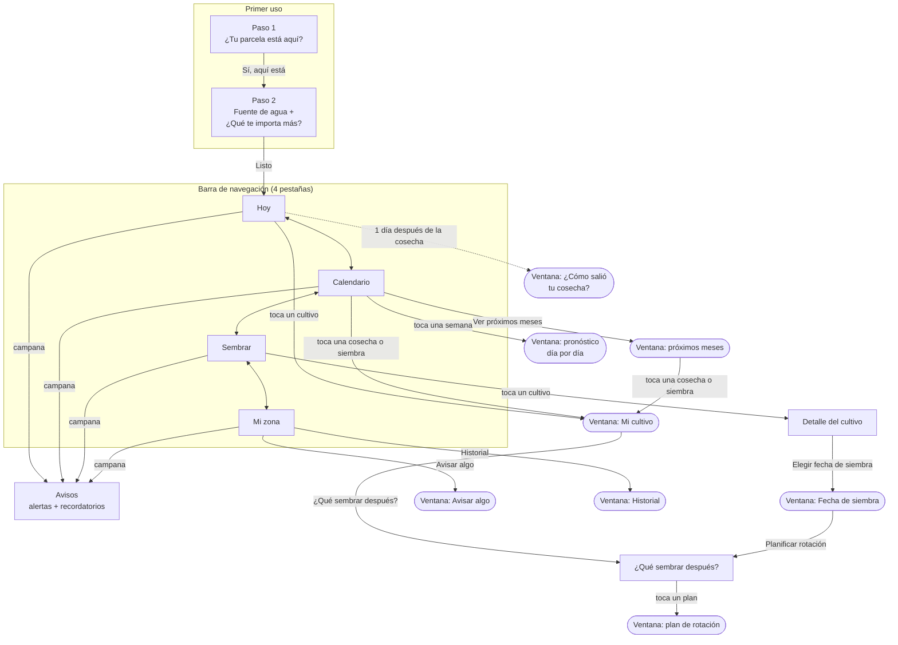
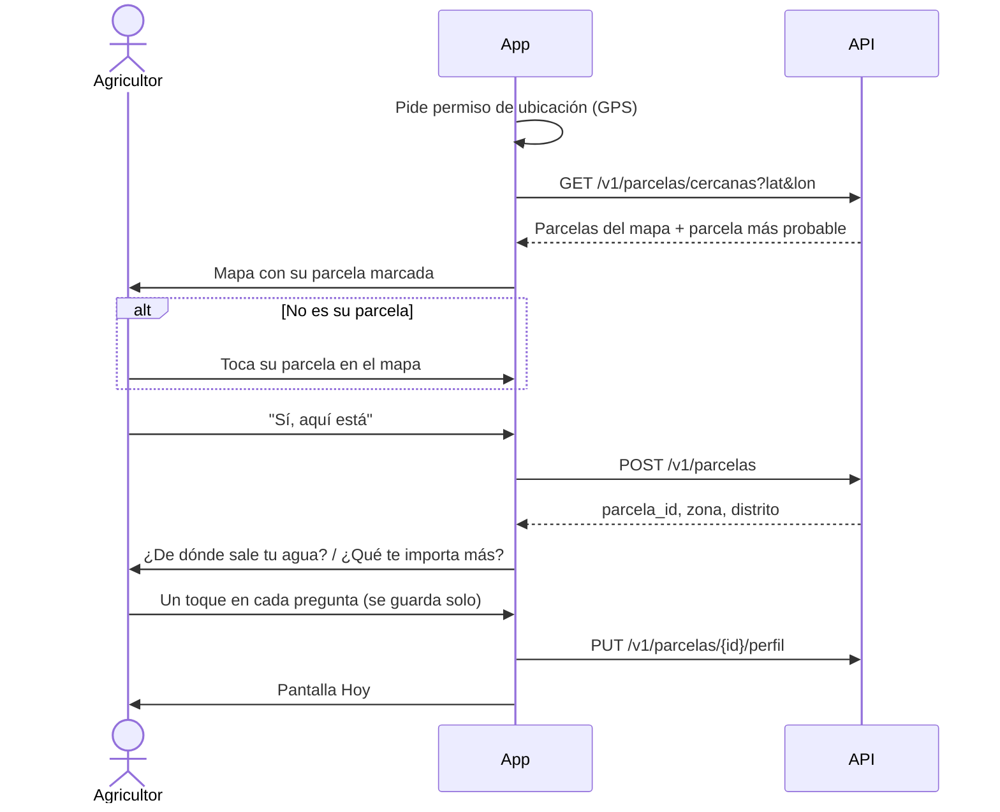
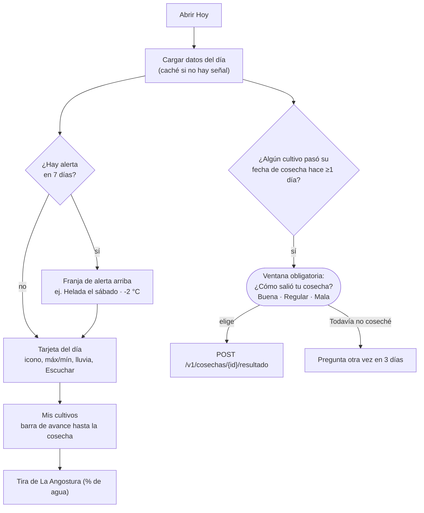
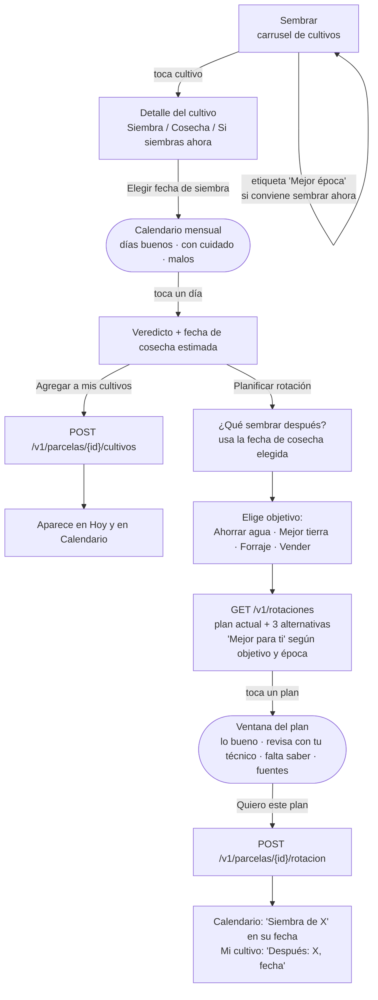
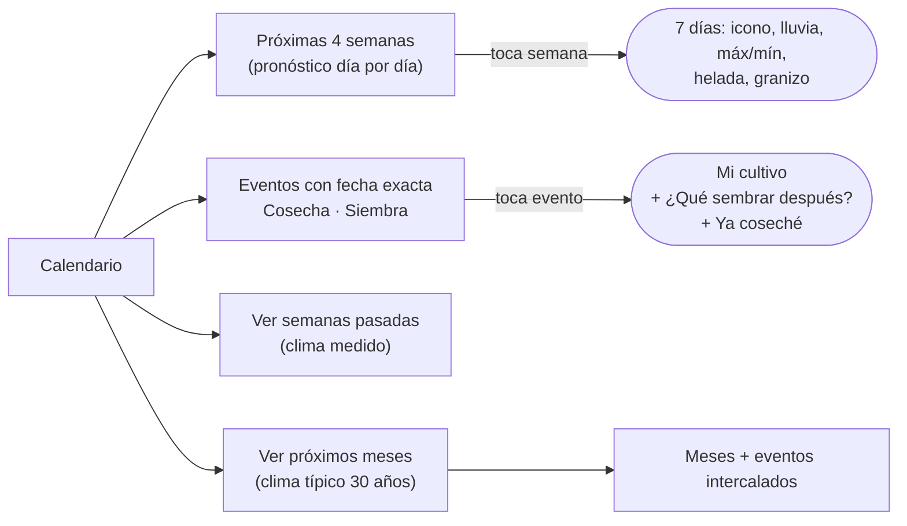
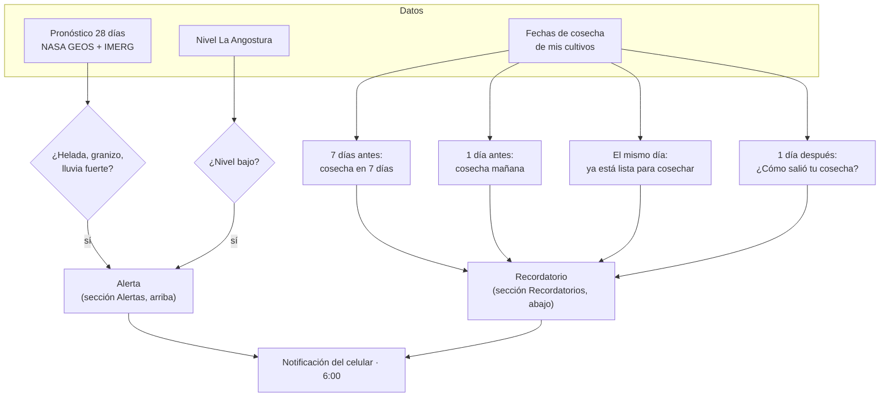
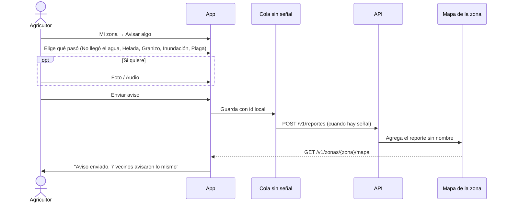
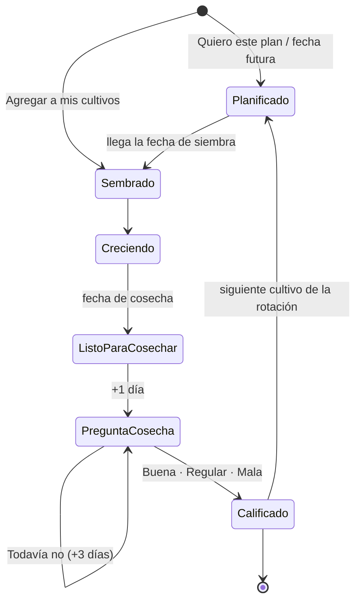
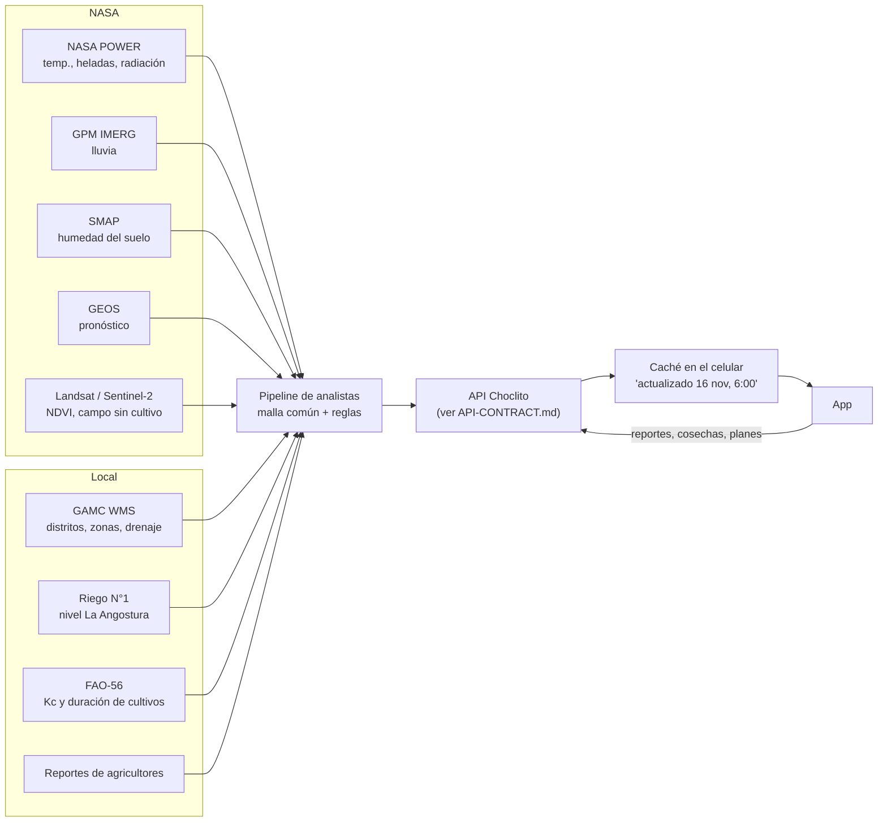

# Choclito — Flujo de la aplicación

Diagramas del flujo de la app según los mockups de `mockups/`. Los diagramas usan [Mermaid](https://mermaid.js.org/) y se ven directo en GitHub.

Pantallas (archivo → nombre):

| Archivo | Pantalla |
|---|---|
| `ubicar.html` | Paso 1 · ¿Tu parcela está aquí? |
| `agua.html` | Paso 2 · Tu parcela (fuente de agua + qué te importa más) |
| `hoy.html` | Hoy |
| `calendario.html` | Calendario |
| `sembrar.html` | Sembrar (carrusel de cultivos) |
| `cultivo.html` | Detalle de un cultivo + elegir fecha de siembra |
| `rotar.html` | ¿Qué sembrar después? (rotaciones) |
| `zona.html` | Mi zona (mapa, avisar algo, historial) |
| `avisos.html` | Avisos (alertas y recordatorios) |

---

## 1. Mapa de navegación

Leyenda: rectángulo = pantalla; óvalo = ventana (bottom sheet) sobre la pantalla.

---

## 2. Primer uso (onboarding)

---

## 3. Hoy

---

## 4. Sembrar, elegir fecha y planificar rotación

---

## 5. Calendario

Las semanas 3 y 4 se marcan como "más lejos, puede cambiar".

---

## 6. Avisos: alertas y recordatorios

---

## 7. Avisar algo y Mi zona

---

## 8. Ciclo de vida de un cultivo

La alfalfa es perenne: después de cada cosecha vuelve a "Creciendo" en lugar de terminar.

---

## 9. Flujo de datos

