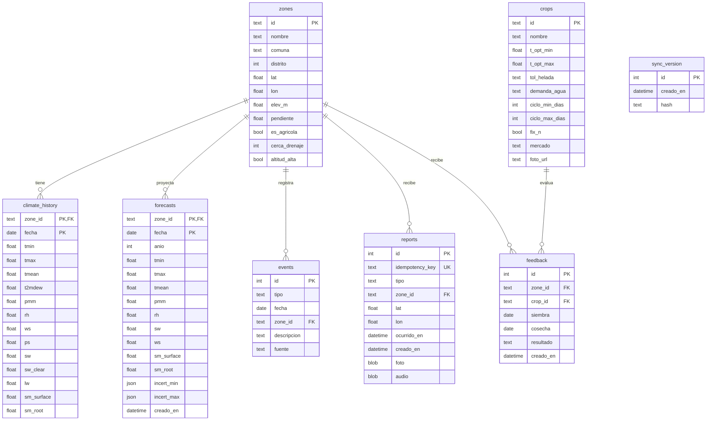

# Esquema de base de datos (SQLite + SQLModel)

Implementado en [`api/models.py`](../api/models.py). Las tablas se crean sin migraciones con
`SQLModel.metadata.create_all()` desde [`api/db.py`](../api/db.py).

Fuente: [`BACKLOG.md`](BACKLOG.md) §5 y [`API-CONTRACT.md`](API-CONTRACT.md) §7.

## Diagrama



## Tablas y columnas

### `zones`

Zonas agrícolas del grid POWER/GAMC. `id` usa los ids del ETL
([`src/etl/points.json`](../src/etl/points.json)), por ejemplo `D9_itocta`.

| Columna | Tipo | Nulo | Nota |
|---|---|---|---|
| `id` | TEXT | no | PK. Id del ETL POWER. |
| `nombre` | TEXT | no | |
| `comuna` | TEXT | no | |
| `distrito` | INTEGER | sí | Número de distrito (`9`), como el contrato §2.1. |
| `lat` / `lon` | REAL | no | WGS84. |
| `elev_m` | REAL | sí | Elevación (m). |
| `pendiente` | REAL | sí | Pendiente (grados o % según SRTM; definir en A2). |
| `es_agricola` | BOOLEAN | no | Default `1`. Mask GAMC de periurbanos. |
| `cerca_drenaje` | INTEGER | sí | Distancia a quebrada (m). |
| `altitud_alta` | BOOLEAN | no | Default `0`. Sobre cota 2750 m. |

### `climate_history`

Serie diaria medida. Conserva todas las columnas que produce
[`src/etl/power_etl.py`](../src/etl/power_etl.py) más humedad de suelo SMAP.

| Columna | Tipo | Nulo | Unidad / nota |
|---|---|---|---|
| `zone_id` | TEXT | no | PK compuesta, FK a `zones.id`. |
| `fecha` | DATE | no | PK compuesta. Día civil. |
| `tmin` / `tmax` | REAL | sí | °C. Nulos antes de 2010 en POWER. |
| `tmean` | REAL | sí | °C. |
| `t2mdew` | REAL | sí | °C. Punto de rocío. |
| `pmm` | REAL | sí | mm/día. |
| `rh` | REAL | sí | %. |
| `ws` | REAL | sí | m/s. |
| `ps` | REAL | sí | kPa. Presión superficial. |
| `sw` | REAL | sí | MJ/m²/día. Radiación solar all-sky. |
| `sw_clear` | REAL | sí | MJ/m²/día. Radiación solar cielo claro. |
| `lw` | REAL | sí | MJ/m²/día. Radiación de onda larga. |
| `sm_surface` | REAL | sí | m³/m³. SMAP 2015+. |
| `sm_root` | REAL | sí | m³/m³. SMAP 2015+. |

La PK `(zone_id, fecha)` crea el índice que necesita el upsert idempotente
`INSERT ... ON CONFLICT (zone_id, fecha)`.

### `crops`

Catálogo de cultivos y vector de condiciones óptimas.

| Columna | Tipo | Nulo | Nota |
|---|---|---|---|
| `id` | TEXT | no | PK. Id de `data/crops/crops.json`. |
| `nombre` | TEXT | no | |
| `t_opt_min` / `t_opt_max` | REAL | sí | °C. Rango de `temp.tmean_opt`. |
| `tol_helada` | TEXT | sí | `alta` / `media` / `baja`. |
| `demanda_agua` | TEXT | sí | `muy alta` / `alta` / `media` / `media-baja`. |
| `ciclo_min_dias` / `ciclo_max_dias` | INTEGER | sí | Rango de `ciclo_dias` del catálogo. |
| `fix_n` | BOOLEAN | no | Default `0`. |
| `mercado` | TEXT | sí | Texto del catálogo (no es un enum cerrado). |
| `foto_url` | TEXT | sí | |

### `events`

Eventos históricos curados (helada, granizo, inundación, sequía).

| Columna | Tipo | Nulo | Nota |
|---|---|---|---|
| `id` | INTEGER | no | PK autoincremental. |
| `tipo` | TEXT | no | Código del evento. |
| `fecha` | DATE | no | |
| `zone_id` | TEXT | sí | FK a `zones.id`. Nulo si el evento cubre todo el valle. |
| `descripcion` | TEXT | sí | |
| `fuente` | TEXT | sí | Código de fuente del contrato §10. |

### `forecasts`

Proyección diaria cacheada por zona.

| Columna | Tipo | Nulo | Nota |
|---|---|---|---|
| `zone_id` | TEXT | no | PK compuesta, FK a `zones.id`. |
| `fecha` | DATE | no | PK compuesta. Día proyectado. |
| `anio` | INTEGER | no | Año de la proyección (contrato §2.3). |
| `tmin` / `tmax` / `tmean` | REAL | sí | °C. |
| `pmm` | REAL | sí | mm/día. |
| `rh` | REAL | sí | %. |
| `sw` | REAL | sí | MJ/m²/día. |
| `ws` | REAL | sí | m/s. |
| `sm_surface` / `sm_root` | REAL | sí | m³/m³. |
| `incert_min` / `incert_max` | JSON | sí | Objeto `{variable: valor}` del contrato §2.3. |
| `creado_en` | DATETIME | no | UTC. Se actualiza al regenerar la cache. |

La PK `(zone_id, fecha)` crea el índice para el upsert idempotente. `anio` se guarda porque
el contrato lo expone, pero no forma parte de la clave.

### `sync_version`

Versión para el sync delta de `GET /sync` (contrato §2.4).

| Columna | Tipo | Nulo | Nota |
|---|---|---|---|
| `id` | INTEGER | no | PK autoincremental. Es el `sync_version` que ve la app. |
| `creado_en` | DATETIME | no | UTC. |
| `hash` | TEXT | no | Hash del paquete (`sha256:...`). |

### `reports`

Reportes de agricultores (`POST /reports`, contrato §7.1).

| Columna | Tipo | Nulo | Nota |
|---|---|---|---|
| `id` | INTEGER | no | PK autoincremental. La API lo expone como `rep-<id>`. |
| `idempotency_key` | TEXT | no | UNIQUE. Valor del header `Idempotency-Key`. |
| `tipo` | TEXT | no | `sin_agua` / `helada` / `granizo` / `inundacion` / `plaga`. |
| `zone_id` | TEXT | no | FK a `zones.id`. |
| `lat` / `lon` | REAL | no | Redondeados a 3 decimales por privacidad. |
| `ocurrido_en` | DATETIME | no | Hora del celular. |
| `creado_en` | DATETIME | no | Hora de recepción en el servidor (UTC). |
| `foto` | BLOB | sí | JPEG <= 300 KB. |
| `audio` | BLOB | sí | Audio <= 60 s. |

### `feedback`

Resultado real de la cosecha (`POST /feedback`, contrato §7.3).

| Columna | Tipo | Nulo | Nota |
|---|---|---|---|
| `id` | INTEGER | no | PK autoincremental. |
| `zone_id` | TEXT | no | FK a `zones.id`. |
| `crop_id` | TEXT | no | FK a `crops.id`. |
| `siembra` | DATE | no | |
| `cosecha` | DATE | no | |
| `resultado` | TEXT | no | `buena` / `regular` / `mala`. |
| `creado_en` | DATETIME | no | UTC. |

## Crear la base de datos

```bash
make db-init    # crea data/app.db con las 8 tablas
make db-reset   # borra y recrea la base desde cero
```

La ruta se controla con `DATABASE_URL` (default `sqlite:///./data/app.db`). Cada conexión
ejecuta `PRAGMA foreign_keys=ON`.

## Decisiones y pendientes de A1

- `distrito` se guarda como entero (`9`) para coincidir con el contrato §2.1. El ETL y GAMC
  usan el código `D9`; la conversión se hace al cargar o al serializar.
- `events.zone_id` es nullable: los eventos históricos pueden afectar a todo el valle.
- `reports.foto` y `reports.audio` se guardan como BLOB en SQLite. Si el volumen crece, mover
  a archivos y guardar la ruta.
- `crops` usa `ciclo_min_dias` / `ciclo_max_dias` porque el catálogo real trae un rango, no
  un entero.
- No se agregaron tablas de planes, embalse, alertas ni pronóstico corto: no están en §5 y
  quedan fuera de A1.
- `climate_history` no guarda `fuente` por fila. El contrato pide fuente por respuesta; si A2
  necesita distinguir POWER/IMERG/SMAP en la misma tabla, habrá que agregar una columna.
- El README de `data/power/` menciona una columna `ts` que el CSV real no trae; el esquema
  sigue las columnas reales del ETL.
