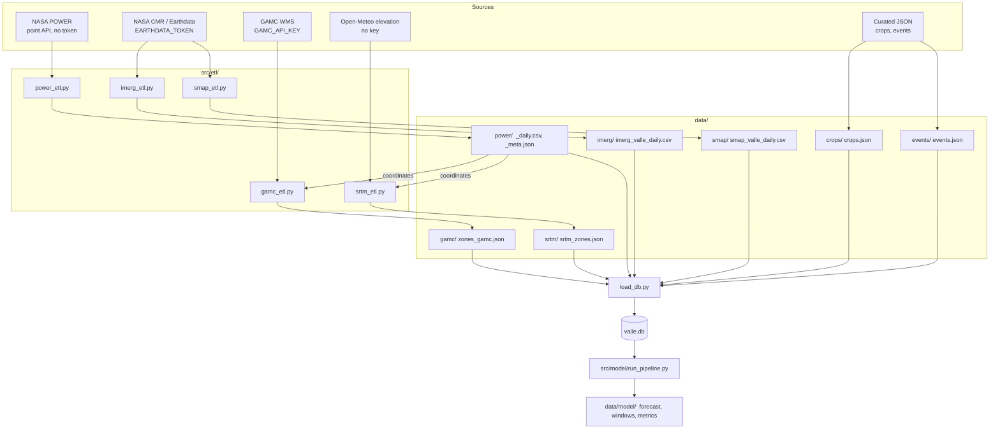
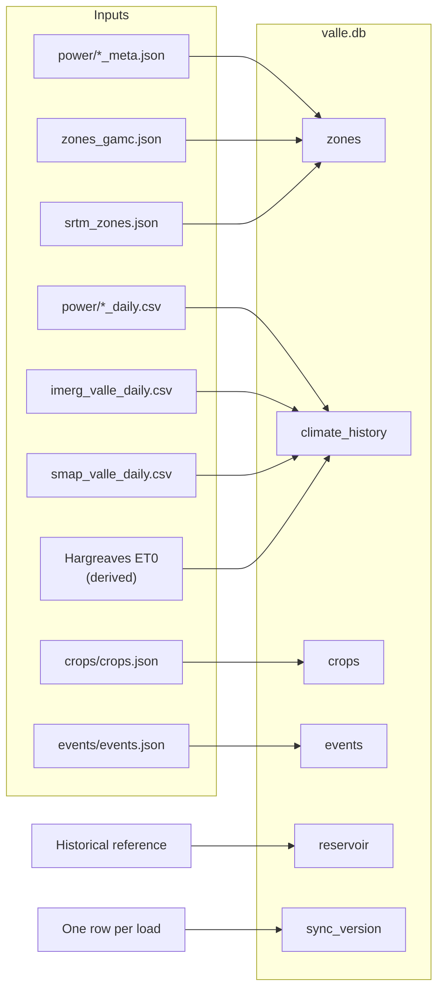
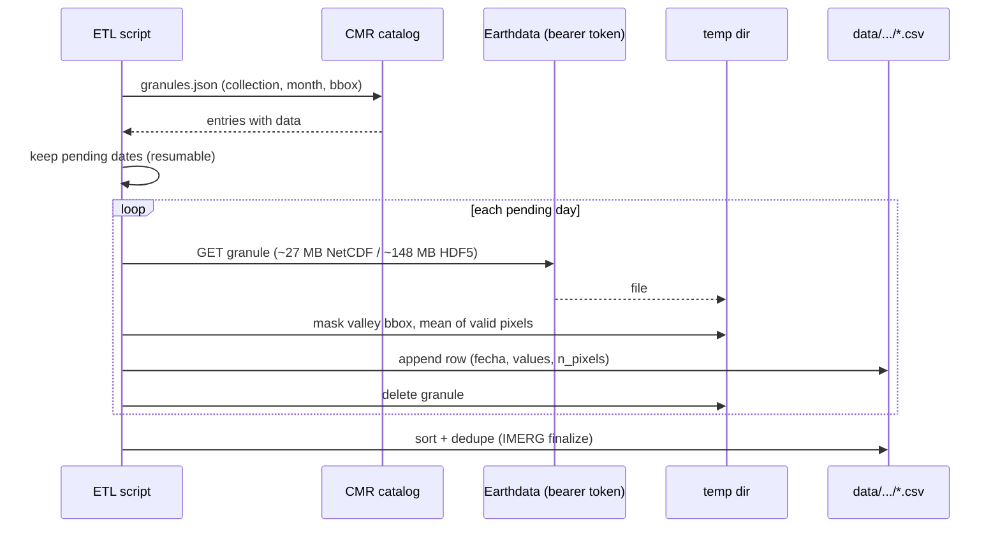

# ETL: extraction and consolidation

This directory holds the extractors that pull environmental and territorial
sources into the `data/` folders, and the loader that consolidates everything
into the SQLite database consumed by the API and the model.

| Script | Source | Auth | Output | Resumable |
|---|---|---|---|---|
| `power_etl.py` | NASA POWER (point API) | none | `data/power/{zone}_daily.csv`, `{zone}_meta.json` | no (re-writes the requested range) |
| `imerg_etl.py` | NASA GPM IMERG Late v07 | `EARTHDATA_TOKEN` | `data/imerg/imerg_valle_daily.csv` | yes (skips dates in the CSV) |
| `smap_etl.py` | NASA SMAP L4 v8 (NSIDC) | `EARTHDATA_TOKEN` | `data/smap/smap_valle_daily.csv` | yes (skips dates in the CSV) |
| `gamc_etl.py` | GAMC WMS + drainage PNG | `GAMC_API_KEY` | `data/gamc/zones_gamc.json` | yes (skips zones in the JSON) |
| `srtm_etl.py` | Open-Meteo Elevation API | none | `data/srtm/srtm_zones.json` | yes (skips zones in the JSON) |
| `load_db.py` | all of the above + curated JSON | none | `data/db/valle.db` | yes (upsert by primary key) |
| `imerg/imerg.py` | NASA GPM IMERG Final + Late (per cell) | Earthdata (interactive) | per-cell SQLite `rain` table | yes (sidecar stamps) |

`imerg/imerg.py` is a standalone program with its own
[`requirements.txt`](imerg/requirements.txt); it is not part of `etl.sh`
(see [the IMERG standalone guide](imerg/README.md)).

## Overall flow



The model pipeline reads the consolidated DB, never the loose CSVs.

## Running it

The orchestrator [`etl.sh`](../etl.sh) runs the steps in dependency order
(`power imerg smap gamc srtm db` by default) and accepts a subset:

```bash
bash etl.sh              # everything, in order
bash etl.sh imerg smap   # only the named steps
bash etl.sh db           # re-consolidate only
```

All steps are idempotent, so `bash etl.sh` works both as a full run and as a
retry of failed steps. Equivalents per step:

| Step | Command |
|---|---|
| power | `python src/etl/power_etl.py --start 1984 --end 2025 --hend 2025` |
| imerg | `python src/etl/imerg_etl.py --start 2016-01-01 --end 2025-12-31 --workers 3` |
| smap | `python src/etl/smap_etl.py --start 2015-04-01 --end 2025-12-31 --workers 5` |
| gamc | `python src/etl/gamc_etl.py --out data/gamc/zones_gamc.json` |
| srtm | `python src/etl/srtm_etl.py --out data/srtm/srtm_zones.json` |
| db | `python -m src.etl.load_db --db data/db/valle.db` |
| model (separate) | `python -m src.model.run_pipeline --db data/db/valle.db --crops data/crops/crops.json --out data/model --eda docs/EDA.md` |

Credentials are read from the `.env` file in the project root (names only in
`.env.example`): `EARTHDATA_TOKEN` (IMERG, SMAP) and `GAMC_API_KEY` (GAMC).
Zone points live in [`points.json`](points.json).

## Sources

### POWER — `power_etl.py`

Point queries against NASA POWER (Power-DA, `community=ag`) for each zone in
`points.json`. The API needs no token.

- **Daily** (`/temporal/daily/point`): `T2M, T2MDEW, RH2M, WS2M, PS, PRECTOT
  (->PRECTOTCORR), TS, ALLSKY_SFC_SW_DWN, ALLSKY_SFC_LW_DWN,
  CLRSKY_SFC_SW_DWN`. Chunks are calendar years (`YYYYMMDD`); the fill value
  `-999` becomes null.
- **Hourly** (`/temporal/hourly/point`, `T2M` only): the daily product has no
  min/max, so `tmin`/`tmax` are derived as the daily min/max of the 8760
  hourly values (`derive_minmax`).
- **Output per zone**: `{zone_id}_daily.csv`
  (`fecha,tmean,tmin,tmax,t2mdew,rh,ws,ps,pmm,sw,sw_clear,lw`) and
  `{zone_id}_meta.json` (`zone_id, nombre, lat, lon, elev_m, start/end,
  hstart/hend, filas`). The meta files are the coordinate source for GAMC,
  SRTM and the DB loader.
- **Time convention**: the service returns local solar time; dates are kept
  as returned and must not be reinterpreted against the UTC sources.
- **Reruns**: the requested range is re-downloaded and the files rewritten;
  it is not resumable mid-range.

### IMERG — `imerg_etl.py`

Valley daily precipitation from GPM IMERG **Late** run v07
(`GPM_3IMERGDL`, collection `C2723754859-GES_DISC`).

- **Catalog**: CMR `granules.json` queried month by month with the valley
  bbox (`-66.40,-17.65,-65.95,-17.15`). The bbox filters which granules are
  intersecting; the granules themselves are global.
- **Download**: global NetCDF4 (~27 MB, one per day) in threads with
  per-thread keep-alive sessions, 3 attempts, and a `Content-Length` check
  (GES DISC can drop the connection mid-body without an HTTP error).
- **Extraction**: in separate processes (the HDF5 library is not thread
  safe). The daily plane of `precipitation` (mm/day) is averaged over the
  valley pixels; NaN and `-9999`-class fill values are excluded.
- **Output**: `data/imerg/imerg_valle_daily.csv` — `fecha` (UTC),
  `pmm_imerg` (mm/day), `n_pixels`. Resumable: dates already in the CSV are
  skipped; `finalize_csv` rewrites the file sorted, keeping the first row of
  any duplicate.

### IMERG standalone — `imerg/imerg.py`

A per-cell program (not the orchestrated valley series): `catalog` builds a
manifest for **Final** (`GPM_3IMERGDF`) and **Late** runs, `download` fetches
granules via earthaccess with sidecar stamps, `process` writes one row per
0.1 degree cell (value, unit check, quality flags, area fraction) into a
SQLite `rain` table, and `report`/`export` summarize coverage. A
`preferred_rain` view prefers Final and falls back to Late per
date/cell/variable. Dates are UTC. See
[`imerg/README.md`](imerg/README.md) and [`imerg/VALIDACION.md`](imerg/VALIDACION.md).
This is the path for the per-cell / Final-Late unification cut after the
hackathon; `etl.sh` does not invoke it.

### SMAP — `smap_etl.py`

Soil moisture from SMAP L4 `SPL4SMGP` v8 (NSIDC, collection
`C3480440870-NSIDC_CPRD`).

- **Catalog**: CMR month by month with the valley bbox. For each day the
  granule closest to **16:30 UTC** (~12:30 local) is selected.
- **Download/extract**: ~148 MB HDF5 granules in a thread pool (`h5py`);
  `sm_surface` and `sm_rootzone` (m³/m³) are nan-averaged over the valley
  cells (`cell_lat`/`cell_lon` mask). Temp granules are deleted after
  extraction.
- **Output**: `data/smap/smap_valle_daily.csv` — `fecha` (UTC), `sm_surface`,
  `sm_root`, `n_pixels`. Resumable by date.

### GAMC — `gamc_etl.py`

Municipal territorial context from the GAMC WMS (project 04).

- **FeatureInfo**: per zone and layer (`periurbanos`, `distritos`), a
  GetFeatureInfo with a ±0.002 degree bbox (≈200 m) at 256×256, center
  pixel. A 12 s pause separates calls (measured rate limit: bursts of 8 get
  429); 429 backs off 30 s; 3 attempts.
- **Drainage**: GetFeatureInfo is not enabled on the drainage layer, so the
  captured PNG `data/gamc/04/mapas/drenaje_e_influencia.png` (800×512, known
  bbox) is sampled: minimum distance in meters from the zone point to a
  non-transparent pixel within 200 m. `null` means "no evidence" (point
  outside the PNG bbox, or nothing within 200 m) — not "confirmed absent".
- **Output**: `data/gamc/zones_gamc.json` — per zone: `lat, lon, elev_m,
  comuna, distrito, periurbano, es_periurbano, cerca_drenaje_m`. Resumable;
  `--force-drainage` recomputes only the PNG distance.

### DEM — `srtm_etl.py`

Elevation and slope from the Open-Meteo Elevation API (~30 m global DEM; the
USGS/CGIAR SRTM 90 m server no longer responds, the name is kept for
continuity).

- Two grids per zone: **3×3** at 0.0003 deg (~33 m) for elevation — the
  representative value is the P15 of the nine heights (valley floor, avoids
  ridge peaks in hillside cells) — and **7×7** at 0.0015 deg (~150 m) for
  slope, from averaged N-S / E-W edge differences (atan of the gradient
  magnitude, degrees; less DEM noise at the coarser step).
- **Output**: `data/srtm/srtm_zones.json` — per zone: `lat, lon, elev_m,
  elev_centro_m, slope_deg, grid_m, sobre_cota_2750` (the 2750 m threshold
  used by the project). Resumable; no key.

### Curated catalogs

- `data/crops/crops.json` (v3): agronomic parameters per crop. No extractor;
  read by `src/model/scoring.py` and `load_db.py`.
- `data/events/events.json`: dated historical references with a `fuente`.
  No extractor; replaced in full on every load.

## Consolidation — `load_db.py`

Merges every source into `data/db/valle.db`. Table shapes are the SQLModel
models in `api/modules/*/models.py` (created via `api.core.db.init_db`).



- **zones** (key `id`): POWER meta + GAMC + DEM joined by `zone_id`.
  `es_agricola` is a proxy (`0` when the zone is periurban, GAMC has no
  agricultural layer); `cerca_drenaje` is meters to the nearest drainage,
  `null` = not within 200 m; `altitud_alta` = elevation ≥ 2750 m.
- **climate_history** (key `zone_id, fecha`): one row per zone-day from the
  POWER CSVs. `et0` is derived with Hargreaves (`tmean, tmax, tmin, doy`).
  `pmm > 100 mm/day` is a known POWER error and becomes NaN. The SMAP and
  IMERG valley series are shared by all zones (same coarse cell / valley
  bbox) and are joined by `fecha`.
- **crops** (key `id`): flattened from `crops.json`.
- **events**: deleted and re-inserted in full each load.
- **reservoir**: La Angostura historical placeholder (2002-11-27, 5 %, ANF).
- **sync_version**: one new row per load, used for delta sync.
- App-owned tables (`forecasts`, `feedback`, `plans`, `reports`) are never
  touched.

Upserts use `INSERT ... ON CONFLICT (key) DO UPDATE`, so the loader is
idempotent and safe to re-run after any extractor.

## Shared download pattern (IMERG, SMAP)



## Conventions

- **Timezones**: IMERG and SMAP dates are **UTC**. POWER keeps the service's
  local-solar-time convention. The model training window is the common range
  of all sources: 2016-01-01 to 2025-12-31.
- **Join keys**: `zone_id` (e.g. `D1_tunari`) links territorial attributes;
  `fecha` (`YYYY-MM-DD`) links the series.
- **Quality handling**: POWER fill `-999` → null; POWER `pmm > 100 mm/day`
  → NaN; drainage `null` = absence of evidence; SMAP uses one granule per
  day (the one closest to 16:30 UTC).
- **Storage**: each source keeps its CSV/JSON next to its own
  `data/*/README.md` (variable dictionaries, periods, units). Large raw
  files (NetCDF, HDF5, GeoTIFF) are never committed; only the processed
  outputs are.
- **Rerunnability**: extractors are re-runnable without duplicating rows
  (resumable CSVs/JSONs, upserts in the DB), except POWER, which rewrites the
  requested range.
