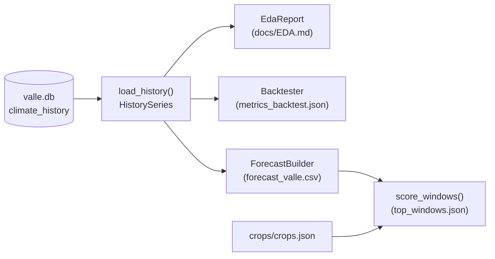

# Model pipeline: training, testing and forecast

This directory holds the climate model: it trains on the consolidated
history, validates the fit, projects the next `--horizon` days, and scores
planting windows per crop. The orchestrator is
[`run_pipeline.py`](run_pipeline.py); the entry point is
`python -m src.model.run_pipeline`.

## Overview



- **Input**: `climate_history` from `data/db/valle.db` (one zone, daily).
  The model reads the DB, never the loose CSVs.
- **Training window**: 2016-01-01 to 2025-12-31 — the common range of all
  sources (POWER 1984+, SMAP 2015+, IMERG 2016+).
- **Variables**: `tmean, tmin, tmax, pmm` (`VARIABLES` in
  [`history.py`](history.py)). `pmm` uses IMERG (`pmm_sat`) as the primary
  source (the 0.5 deg POWER cell underestimates Andean convective rain) with
  POWER `pmm` as fallback; values above 100 mm/day are treated as data
  errors (NaN).
- **Outputs**: `data/model/forecast_valle.csv`, `data/model/top_windows.json`,
  `data/model/metrics_backtest.json`, `docs/EDA.md`.

## Training

The model is a per-variable **Fourier series with 4 harmonics plus a linear
trend**, fitted by least squares (numpy, no external fit library). See
[`seasonal.py`](seasonal.py). A step-by-step reference of the training,
validation and forecast, with diagrams, is in
[TRAINING.md](TRAINING.md).

- Time base: `t = days since the first date` (`np.arange(len(dates))`);
  the year constant is 365.25 days.
- Design matrix (`_design`): intercept, linear trend, then a cos/sin pair
  for each harmonic k = 1..4 (10 columns).
- `fit(y, t)` → `Fit(coef, sigma, t_start, t_end, n)`, where `sigma` is the
  residual standard deviation (ddof=2). NaN days are excluded with
  `valid_mask` before fitting.
- `predict(fit, t)` evaluates the design matrix at new times.
- `SeasonalModel` wraps a fit for one variable with `predict` / `forecast` /
  `backtest` methods.

## Testing

Two complementary validations, both run by the pipeline:

### Backtest (holdout 2024–2025)

`Backtester(series, horizon=731).metrics("2024-01-01")`
([`backtest.py`](backtest.py), built on `seasonal.backtest`):

1. Fit on all days **before** the holdout start.
2. Predict 731 days from the holdout start.
3. Compare against the observed series (NaN handled with `np.interp`) and
   report **MAE / RMSE per variable**.

Results land in `data/model/metrics_backtest.json` together with the EDA
summary.

### EDA (local-knowledge checks)

`EdaReport` ([`eda.py`](eda.py)) computes the monthly climatology and
validates the series against the valley's expected patterns; each check is
name / pass / detail:

| Check | Rule |
|---|---|
| Rain concentrated Dec–Feb | rainy-season mean > 2× the annual monthly mean |
| Dry season May–Sep | dry mean < 25% of the rainy-season mean |
| Frost May–Aug | daily-minimum `tmin` < 0 °C in all four months |
| Mild valley | annual mean `tmean` within 10–20 °C |

It also reports annual precipitation from IMERG vs POWER (the source
harmonization decision) and renders `docs/EDA.md`.

## Forecast

`ForecastBuilder(series, horizon, today).build()`
([`forecast.py`](forecast.py)) fits each variable over the full history and
projects `horizon` days starting **tomorrow** (index 0 = tomorrow):

- **Mean**: the fitted model evaluated at `t_today + h`.
- **Uncertainty band**: `band(h) = 1.96 · sigma · sqrt(1 + h/180)` — it
  doubles at 180 days and keeps growing with the horizon.
- **Clipping**: `pmm` and the derived `et0` are clipped at 0.
- **ET0**: Hargreaves (`et0_hargreaves` in [`et0.py`](et0.py)) computed from
  the forecast `tmean/tmax/tmin` and day-of-year.

`write_forecast_csv` writes one row per day:
`fecha, tmean, tmin, tmax, pmm, et0, {var}_baja, {var}_alta` for tmean/tmin/
pmm, plus `et0_baja`/`et0_alta` (±20% of the tmean band).

## Scoring

`score_windows(crop, zone, dates, tmean, tmin, pmm, et0, ...)`
([`scoring.py`](scoring.py)) slides L-day windows (L = half the crop cycle)
over the forecast and scores each one:

```
score = 100 · (0.45·temp + 0.40·water + 0.15·frost) · erosion
```

with `veredicto` (≥70 `bueno`, ≥40 `con_cuidado`, else `malo`; thresholds
configurable), a `confianza` heuristic that decays with the window center,
and `motivos` as **codes** (the app translates them via i18n). Top-3 windows
are separated by ≥ 14 days. `scoring.py` is the reference implementation
shared with the mobile app: the published test vectors in
`data/model/test_vectors.json` are the portability contract.

## Plots (progress and metrics)

[`plot_report.py`](plot_report.py) renders the model's progress as PNG
charts (matplotlib, headless `Agg` backend):

| File | Content |
|---|---|
| `training_fit.png` | history + Fourier+trend fit per variable |
| `backtest_holdout.png` | holdout observed vs predicted, MAE/RMSE per panel |
| `metrics_summary.png` | MAE/RMSE bar chart per variable |
| `forecast_bands.png` | forecast mean + uncertainty bands per variable |

```bash
.venv/bin/python -m src.model.plot_report \
    --db data/db/valle.db --zone D1_tunari \
    --horizon 365 --today 2026-11-15 --out docs/plots
```

## Reproducing

```bash
.venv/bin/python -m src.model.run_pipeline \
    --db data/db/valle.db \
    --crops data/crops/crops.json \
    --out data/model --eda docs/EDA.md \
    --horizon 365 --today 2026-11-15
```

- `--today` pins the forecast start (default: system date) so outputs are
  reproducible.
- Re-running replaces the outputs at those paths.
- Tests: `.venv/bin/python -m pytest -q` and
  `.venv/bin/python -m unittest discover -s tests` (scoring vectors, history
  loading, pipeline).

## Importing from the API

The API (`api/`) can import the public surface below. All functions are
pure/IO-local and take plain paths and arrays; there is no global state.

| Import | Purpose |
|---|---|
| `src.model.history.load_history(db, zone_id, start, end) -> HistorySeries` | Read the consolidated daily series (`dates`, `fields`) |
| `src.model.history.HistorySeries` | Dataclass: `dates: list[str]`, `fields: dict[str, np.ndarray]`, `n_days` |
| `src.model.forecast.ForecastBuilder(series, horizon, today).build() -> ForecastResult` | Fit + project `horizon` days from `today` |
| `src.model.forecast.ForecastResult` | Dataclass: `dates`, `fields` (mean), `bands` (±), `et0` |
| `src.model.forecast.write_forecast_csv(result, out)` | Write the forecast CSV (columns above) |
| `src.model.scoring.load_crops(path) -> list[dict]` | Crop catalog entries |
| `src.model.scoring.score_windows(crop, zone, dates, tmean, tmin, pmm, et0, ...) -> list[dict]` | Top-3 windows per crop |
| `src.model.scoring.veredicto(score, umbral_bueno=70, umbral_malo=40) -> str` | Score → verdict mapping |
| `src.model.backtest.Backtester(series, horizon).metrics(holdout_start)` | MAE/RMSE per variable |
| `src.model.eda.EdaReport(series, db, zone_id)` | Climatology, checks, `summary()`, `render()`, `write()` |
| `src.model.seasonal.fit / predict / forecast / backtest / SeasonalModel` | Low-level Fourier+trend primitives |
| `src.model.et0.et0_hargreaves(tmean, tmax, tmin, doy)` | Reference evapotranspiration (mm/day) |

Minimal example — generate a forecast the same way the pipeline does:

```python
from datetime import date
from pathlib import Path

from src.model.forecast import ForecastBuilder, write_forecast_csv
from src.model.history import load_history
from src.model.scoring import load_crops, score_windows

series = load_history(Path("data/db/valle.db"), "D1_tunari", "2016-01-01", "2025-12-31")
result = ForecastBuilder(series, 365, date.today()).build()
write_forecast_csv(result, Path("data/model/forecast_valle.csv"))

zone = {"cerca_drenaje": None, "elev_m": 3126}  # valley-wide cut
for crop in load_crops("data/crops/crops.json"):
    windows = score_windows(
        crop,
        zone,
        result.dates,
        [float(x) for x in result.fields["tmean"]],
        [float(x) for x in result.fields["tmin"]],
        [float(x) for x in result.fields["pmm"]],
        [float(x) for x in result.et0],
    )
```

### Current serving path (and the gap)

The API does **not** import `src.model` today. It serves forecasts from the
`forecasts` table:

- `api/modules/climate/repository.py` → `forecast_days(session, zone_id)`
- `api/modules/climate/service.py` → `forecast(session, zone_id)` (adds
  `fuente`, `incert_min`/`incert_max` from the band columns)
- router: `GET /api/v1/climate/{zone_id}`

The `forecasts` table (`api/modules/climate/models.py::Forecast`) is not
populated by the pipeline yet: the pipeline writes `forecast_valle.csv`.
Bridging the two is a pending integration step — the mapping is direct:

| `ForecastResult` | `forecasts` column |
|---|---|
| `dates[i]` | `fecha` (and `anio`) |
| `fields["tmean"/"tmin"/"tmax"/"pmm"][i]` | same names |
| `et0[i]` | `et0` |
| `bands["tmin"][i]` | `tmin_min` / `tmin_max` |
| `bands["pmm"][i]` | `pmm_min` / `pmm_max` |

Zone id in this cut is valley-wide (`D1_tunari` is the reference zone);
per-zone drainage scoring is not in the current cut.
