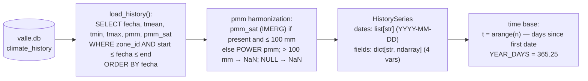
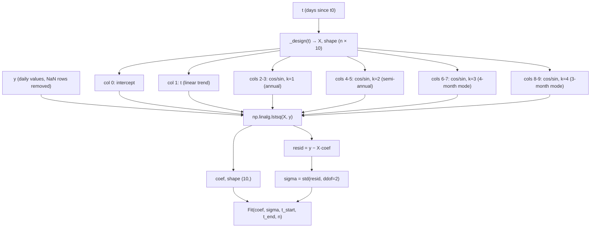
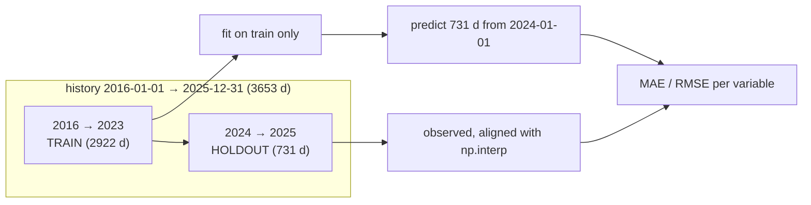
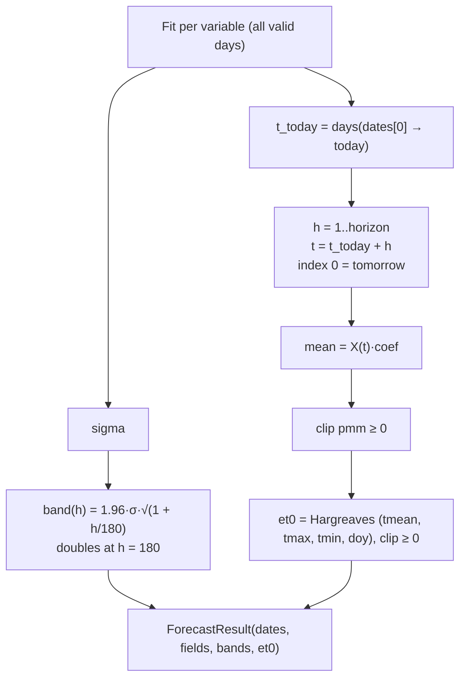
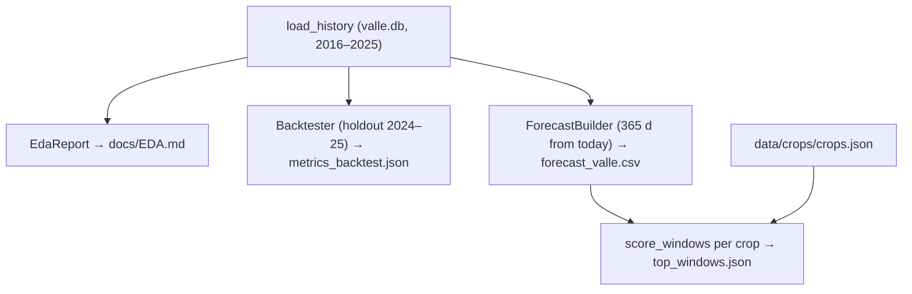

# Model training — detailed reference

Step-by-step account of how the climate model is prepared, trained,
validated and applied. It complements [README.md](README.md); all code
references are to files in `src/model/`.

## 1. What is modeled, and why this model family

- **Targets**: daily `tmean`, `tmin`, `tmax`, `pmm` for the valley
  (reference zone `D1_tunari`). One independent model per variable.
- **Model**: Fourier series with 4 harmonics plus a linear trend, fitted
  by closed-form least squares (numpy only).
- **Why**:
  - The series is dominated by the annual cycle plus a weak long-term
    trend. A 10-parameter model is comfortably identifiable from 3,653
    daily points.
  - Deterministic and explainable: any forecast is reproducible from 10
    coefficients, which matters for a farmer-facing app and for the
    mobile port that has no ML runtime.
  - No external ML dependency: numpy least squares, no iteration, no
    hyperparameters, no convergence risk.

## 2. Data preparation



- **Source table**: `climate_history` in `data/db/valle.db`, consolidated
  by `src/etl/load_db.py` (POWER + IMERG + SMAP + derived ET0).
- **`load_history(db, zone_id, start, end)`** ([`history.py`](history.py)):
  - SQL range read, ordered by date.
  - **pmm harmonization**: IMERG (`pmm_sat`) is the primary source — the
    0.5° POWER cell underestimates Andean convective rain (annual:
    967 mm IMERG vs 449 mm POWER in the EDA) — with POWER `pmm` as
    fallback. Any value above 100 mm/day is a known data error and
    becomes NaN; NULL stays NaN.
- **Training window**: 2016-01-01 → 2025-12-31 (3,653 days) — the common
  range of all sources (POWER 1984+, IMERG 2016+, SMAP 2015+).
- **Time base**: `t = np.arange(n)` (float days since the first date).
  Seasonal terms use `YEAR_DAYS = 365.25`.

## 3. Model structure



Design matrix `_design(t)` ([`seasonal.py`](seasonal.py)):

| cols | term | captures |
|---|---|---|
| 0 | `1` | level (intercept) |
| 1 | `t` | linear trend |
| 2–3 | `cos/sin(2π·1·t/365.25)` | annual cycle |
| 4–5 | `cos/sin(2π·2·t/365.25)` | semi-annual |
| 6–7 | `cos/sin(2π·3·t/365.25)` | 4-month mode |
| 8–9 | `cos/sin(2π·4·t/365.25)` | 3-month (sub-seasonal) |

Each harmonic is a **cos/sin pair**, which makes the fit phase-free: the
seasonal peak can land on any day of the year without choosing a reference
phase.

## 4. Training (the fit)

`fit(y, t)` ([`seasonal.py`](seasonal.py)):

1. `X = _design(t)`
2. `coef = np.linalg.lstsq(X, y)` — closed-form solution of the normal
   equations. No iteration, no learning rate, no seed: the result is exact
   and reproducible.
3. `resid = y − X·coef`; `sigma = std(resid, ddof=2)` — residual
   standard deviation; it parameterizes the forecast uncertainty band.
4. Returns `Fit(coef, sigma, t_start, t_end, n)`.

**NaN handling**: callers drop NaN days before fitting (`valid_mask`), so
`lstsq` always sees complete rows. Missing days do not bias the fit; they
only reduce `n`.

`SeasonalModel` wraps one variable's fit with `predict` / `forecast` /
`backtest` methods for API-style use.

## 5. Validation

### 5.1 Backtest (holdout 2024–2025)



`backtest(y, t, holdout_start, horizon)` /
`Backtester(series, 731).metrics("2024-01-01")`
([`backtest.py`](backtest.py), built on [`seasonal.py`](seasonal.py)):

1. Fit using only `t < t_holdout` (2016-01-01 → 2023-12-31, 2,922 d).
2. Predict `h = 1..731` starting at the holdout boundary.
3. Align observations with `np.interp` (robust to gaps).
4. `MAE = mean(|pred − obs|)`, `RMSE = sqrt(mean((pred − obs)²))`.

Current results (`data/model/metrics_backtest.json`):

| variable | MAE | RMSE |
|---|---|---|
| tmean (°C) | 1.167 | 1.466 |
| tmin (°C) | 1.546 | 1.923 |
| tmax (°C) | 1.942 | 2.410 |
| pmm (mm) | 3.092 | 6.955 |

Reading: a typical daily temperature error is about 1–2 °C; the RMSE/MAE
ratio above 1.5 shows occasional large errors (convective days for `pmm`,
frost nights for `tmin`) that a seasonal mean cannot place exactly.

### 5.2 EDA (local-knowledge checks)

`EdaReport` ([`eda.py`](eda.py)) validates the series against expected
valley patterns; each check is name / pass / detail:

| Check | Rule | Current value |
|---|---|---|
| Rain concentrated Dec–Feb | rainy mean > 2× annual monthly mean | 5.6 mm/day |
| Dry season May–Sep | dry mean < 25% of rainy mean | 0.7 mm/day |
| Frost May–Aug | daily-min `tmin` < 0 °C in all four months | months 5–8 |
| Mild valley | annual mean `tmean` within 10–20 °C | passed |

It also reports the source-harmonization decision (IMERG 967 mm/y vs
POWER 449 mm/y) and renders `docs/EDA.md`. Current status: **4/4 passed**.

## 6. Applying the trained model (forecast)



`ForecastBuilder(series, horizon, today).build()` ([`forecast.py`](forecast.py)):

- **Mean**: each variable is fitted over the full history (NaN rows
  removed) and evaluated at `t_today + h`, `h = 1..horizon`. Index 0 is
  **tomorrow** (`today + 1 day`).
- **Uncertainty band**: `band(h) = 1.96 · σ · sqrt(1 + h/180)`. It is a
  ~95% band under a Gaussian-residual assumption; it equals 1.96σ at
  h → 0, doubles at h = 180, and keeps growing with the horizon.
- **Clipping**: `pmm` and derived `et0` are clipped at 0.
- **ET0** ([`et0.py`](et0.py)): Hargreaves, FAO-56 Eq. 52 —
  `ET0 = 0.0023·(tmean + 17.8)·sqrt(tmax − tmin)·Ra_mm`, where
  `Ra_mm = 0.408 · Ra_MJ` and `Ra` is the extraterrestrial radiation
  (FAO-56 Eq. 11) at latitude −17.4°, solar constant 0.0820 MJ/m²/min.
  Temperature-only method, which is why it can be derived from the
  forecast without a radiation model.
- **CSV** (`write_forecast_csv`): one row per day with `fecha, tmean,
  tmin, tmax, pmm, et0` plus `_baja`/`_alta` columns for tmean/tmin/pmm;
  the ET0 band is expressed as ±20% of the tmean band.

## 7. End-to-end pipeline



`Pipeline.run()` ([`run_pipeline.py`](run_pipeline.py)) orchestrates
load → EDA → backtest → forecast → scoring and writes all outputs:

| Output | Content |
|---|---|
| `docs/EDA.md` | climatology, local-knowledge checks, source decision |
| `data/model/metrics_backtest.json` | MAE/RMSE per variable + EDA summary |
| `data/model/forecast_valle.csv` | 365-day forecast with bands |
| `data/model/top_windows.json` | top-3 planting windows per crop |

Scoring ([`scoring.py`](scoring.py)) is a deterministic rule on the
forecast (not a learned model): `score = 100·(0.45·temp + 0.40·water +
0.15·frost)·erosion` with verdicts, confidence decay and code-based
`motivos`; see [README.md](README.md#scoring).

## 8. Limitations

- **Stationarity**: the linear trend assumes the recent regime continues.
  Regime shifts (climate change, land use) are not modeled; beyond ~1
  year the trend term dominates the projection.
- **Parametric band**: the band assumes Gaussian residuals; true
  coverage can differ, especially for `pmm` (heavy right tail).
- **Valley-scale precipitation**: the IMERG pixel / POWER cell is shared
  by all zones; local storms are not resolved.
- **No weather-scale events**: a seasonal model cannot place individual
  storms or frost nights; it estimates their climatology.
- **pmm harmonization**: IMERG is preferred over POWER by design; the
  decision and its rationale are documented in `docs/EDA.md`.

## 9. Reproducing

```bash
# full pipeline (EDA + backtest + forecast + scoring)
.venv/bin/python -m src.model.run_pipeline \
    --db data/db/valle.db --crops data/crops/crops.json \
    --out data/model --eda docs/EDA.md \
    --horizon 365 --today 2026-11-15

# progress and metrics charts (matplotlib)
.venv/bin/python -m src.model.plot_report \
    --db data/db/valle.db --zone D1_tunari \
    --horizon 365 --today 2026-11-15 --out docs/plots
```

- `--today` pins the forecast start so outputs are reproducible.
- Tests: `.venv/bin/python -m pytest -q` and
  `.venv/bin/python -m unittest discover -s tests`.
